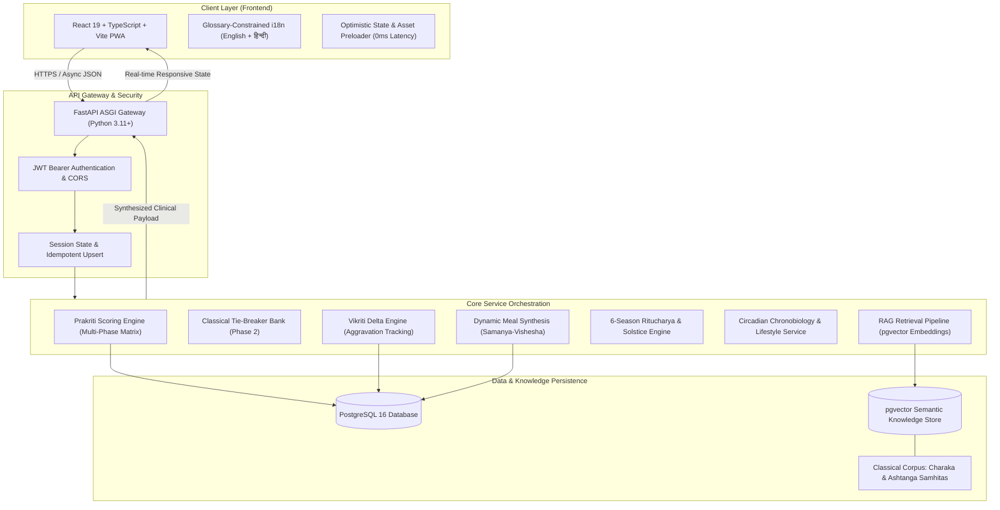
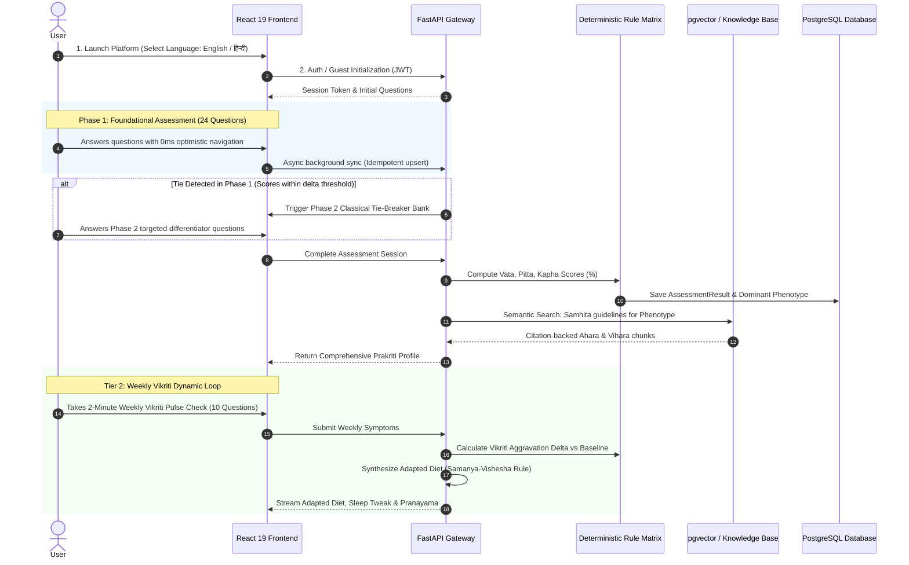

# AYUSHYA (RAG-Veda) — High-Level System Architecture

> **"Know your Prakriti. Adapt to your Vikriti. Live in natural balance."**
> 
> *A Smart India Hackathon (SIH 2026) Initiative for Intelligent Ayurvedic Phenotyping and Preventive Healthcare.*

---

## 1. Executive Summary & Vision

Modern commercial wellness treats human bodies as identical biological machines, offering generic diets, unverified internet remedies, or hallucinating black-box chatbots. However, classical Ayurveda establishes that **every individual possesses a distinct, congenital biological phenotype (*Prakriti*)** and experiences **transient, real-time imbalances (*Vikriti*)** influenced by stress, diet, sleep, and seasonal shifts.

**AYUSHYA** is an explainable, Hybrid-AI preventive healthcare platform that solves this fundamental problem through a **continuous 2-Tier Dynamic Health Loop**:
1. **Tier 1 (Foundational Baseline):** Diagnoses the lifelong congenital phenotype (*Prakriti*) using a clinically-validated, zero-latency multi-phase assessment.
2. **Tier 2 (Real-Time Adaptation):** Tracks shifting dosha elevations (*Vikriti*) via a 2-minute weekly check-in and dynamic 6-season (*Ritucharya*) overlays, adjusting daily meals, spices, sleep windows, and movement regimens.

```
+---------------------------------------------------------------------------------------+
|                                    AYUSHYA PLATFORM                                   |
+---------------------------------------------------------------------------------------+
|                                                                                       |
|   +--------------------------+                         +--------------------------+   |
|   |    Prakriti Diagnosis    |                         |     Vikriti Tracking     |   |
|   |  (Foundational Baseline) |                         |   (Real-Time Imbalance)  |   |
|   +------------+-------------+                         +------------+-------------+   |
|                |                                                    |                 |
|                |                   2-TIER SYNTHESIS                 |                 |
|                +-------------------------->+<-----------------------+                 |
|                                            |                                          |
|                                            v                                          |
|                         +-------------------------------------+                       |
|                         |    Dynamic Preventive Guidance      |                       |
|                         |  - Adapted Diet (Dinacharya Ahara)  |                       |
|                         |  - Sleep Protocols (Nidra)          |                       |
|                         |  - Classical Exercise (Ardha-Shakti)|                       |
|                         |  - Breathwork (Pranayama)           |                       |
|                         |  - 6-Season Overlays (Ritucharya)   |                       |
|                         +-------------------------------------+                       |
+---------------------------------------------------------------------------------------+
```

---

## 2. The Core Ayurvedic Philosophy & Clinical Distinction

| Concept | Ayurvedic Principle | Role in AYUSHYA | Analogy |
| :--- | :--- | :--- | :--- |
| **Prakriti (प्रकृति)** | Congenital constitution formed at conception based on Tridosha ratios (*Vata, Pitta, Kapha*). Immutable throughout life. | Sets the foundational lifestyle, baseline dietary affinities, metabolic temperament, and constitutional strengths. | Your biological **DNA / Blood Group**. |
| **Vikriti (विकृति)** | Active deviation or transient dosha elevation caused by stress, poor sleep, diet errors, or environmental factors. | Tracked weekly to dynamically adjust recipes, herbs, bedtime rituals, and workout intensity. | Your real-time **Pulse / Dashboard**. |
| **Agni (अग्नि)** | Metabolic & digestive fire responsible for nutrient assimilation and biological transformation. | Modulates meal density, cooking methods, and spice pairings. | The body's **Internal Engine**. |
| **Dinacharya (दिनचर्या)** | Circadian chronobiology aligning self-care with nature's 4-hour dosha shifts across 24 hours. | Guides oral hygiene (*Gandusha/Kavala*), peak digestion windows, and wind-down rituals. | The body's **Circadian Clock**. |
| **Ritucharya (ऋतुचर्या)** | Seasonal regimen adapting lifestyle across India's 6 classical seasons (*Ritus*) and 2 Solstices (*Kalas*). | Dictates seasonal food favor/reduce lists and Solstice energy (*Bala*) management. | The body's **Seasonal Calendar**. |

---

## 3. High-Level System Architecture

AYUSHYA employs a **Hybrid AI Architecture**:
* **Deterministic Rule Matrix:** 100% mathematical and explainable for clinical Dosha scoring (zero black-box ambiguity or hallucination).
* **Retrieval-Augmented Generation (RAG):** Contextual semantic grounding from vectorized classical Samhitas (*Charaka Samhita*, *Ashtanga Hridaya*) using `pgvector`.



---

## 4. End-to-End User Journey



---

## 5. Core Platform Modules

### 5.1 Intelligent Multi-Phase Prakriti Assessment
* **Phase 1 (Foundational Bank):** 24 questions across 4 clinical domains (Physical Anatomy, Physiology & Digestion, Psychological Temperament, Behavioral Patterns).
* **Phase 2 (Dynamic Tie-Breaker Bank):** Triggered automatically when two doshas have identical or near-identical scores, resolving ambiguity using classical diagnostic markers.
* **0ms Optimistic Transitions:** Client transitions questions instantly in 0ms, queuing answers in the background without UI spinners or blocking.

### 5.2 Weekly Vikriti Feedback Loop
* A 10-question weekly pulse check assessing transient changes in digestion, sleep, mood, body temperature, and energy.
* Computes delta variance ($\Delta$) against the user's birth baseline.
* Dynamically updates the dashboard badge, comparison bars, and actionable guidance.

### 5.3 2-Tier Personalized Diet Planner
* **Level 1 (Baseline Prakriti Diet):** Lifelong constitutional food compatibility list.
* **Level 2 (Weekly Adapted Diet):** Dynamically alters breakfast, lunch, and dinner recipes based on active Vikriti. (e.g., if Vata spikes, raw cold foods are replaced with warm, spiced grounding stews with cow's ghee).
* **Classical Principle:** Implements *Samanya-Vishesha Siddhanta* (like increases like, opposites balance).

### 5.4 Circadian Dinacharya & Lifestyle Guide
* **4-Phase Circadian Clock:** Early Morning (Kapha period: cleansing, *Gandusha* holding vs *Kavala* gargling), Midday (Pitta period: peak *Agni*, primary meal), Afternoon (Vata period: creativity & light hydration), Evening (Kapha period: settling, *Pada Abhyanga* foot massage).
* **Classical Sleep (*Nidra*):** Constitutional sleep windows and wind-down rituals.
* **Exercise (*Vyayama*):** Strict adherence to the classical **Ardha-Shakti** (half-capacity) rule to prevent tissue depletion (*Dhatu Kshaya*).
* **Breathwork (*Pranayama*):** Step-by-step techniques with explicit health contraindications (e.g., pregnancy, high blood pressure).

### 5.5 Ritucharya: Classical 6-Season Regimen
* Encompasses all 6 Indian seasons: **Shishir** (Late Winter), **Vasant** (Spring), **Grishma** (Summer), **Varsha** (Monsoon), **Sharad** (Autumn), and **Hemant** (Early Winter).
* Classified under Northern Solstice (**Adana Kala** / depleting) and Southern Solstice (**Visarga Kala** / strengthening).
* Tracks *Chaya* (accumulation), *Prakopa* (aggravation), and *Prashama* (pacification) cycles, plus the 14-day **Ritu Sandhi** seasonal junction protocol.

### 5.6 Glossary-Constrained Multilingual Engine
* Seamless dual-language interface (English and हिन्दी).
* **Sanskrit Glossary Guard:** Prevents machine-translation errors (e.g., *Vata* is never translated as "Wind", *Agni* is never translated as "Fire", and *Ama* is never translated as "Mucus").
