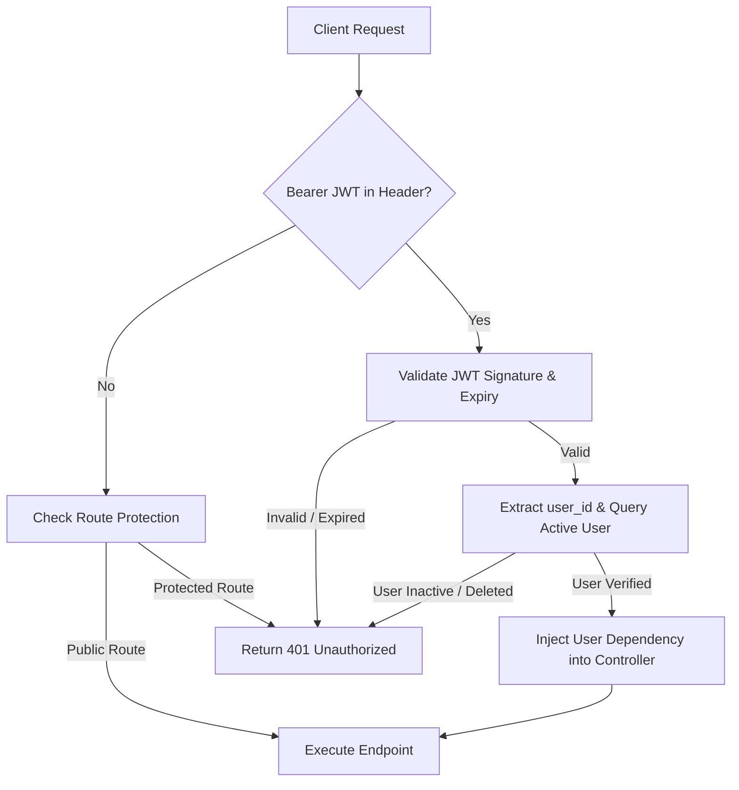

# AYUSHYA (RAG-Veda) — Low-Level Technical Architecture

> **Deep-dive engineering specifications, frontend component hierarchy, backend async service pipelines, scoring algorithms, and state management.**

---

## 1. Directory Structure & Technology Stack

```
SIH-2026/
├── backend/                        # FastAPI Python Backend
│   ├── app/
│   │   ├── core/                   # Config, security, JWT helpers
│   │   ├── data/                   # Canonical questions & Samhita content
│   │   ├── db/                     # Async session manager & engine
│   │   ├── models.py               # SQLModel DB entity declarations
│   │   ├── schemas.py              # Pydantic validation & response DTOs
│   │   ├── routers/                # REST API controllers
│   │   │   ├── assessment.py       # Prakriti multi-phase endpoints
│   │   │   ├── auth.py             # JWT, OAuth, OTP verification
│   │   │   ├── diet.py             # 2-Tier dynamic diet planner
│   │   │   ├── recommendations.py  # Dinacharya, sleep, workout, breathwork
│   │   │   ├── ritucharya.py       # 6-Season seasonal intelligence
│   │   │   └── vikriti.py          # Weekly dynamic pulse check endpoints
│   │   └── services/               # Clinical algorithms & RAG pipelines
│   │       ├── diet_plan.py        # Samanya-Vishesha dynamic meal synthesis
│   │       ├── llm_client.py       # RAG inference & prompt engineering
│   │       ├── prakriti_scoring.py # Multi-phase mathematical matrix
│   │       ├── retrieval.py        # pgvector cosine similarity search
│   │       └── ritucharya.py       # Astronomical solar calendar mapper
│   └── scripts/                    # CLI test suites & vector seeding
├── frontend/                       # React 19 + TypeScript Frontend
│   ├── src/
│   │   ├── assets/                 # SVGs, brand assets, question diagrams
│   │   ├── components/             # Reusable UI components
│   │   │   ├── AppShell.tsx        # Responsive layout & segmented language pill
│   │   │   ├── DoshaEducationModal.tsx # Bilingual dosha deep-dive modal
│   │   │   └── ProtectedRoute.tsx  # Auth-gated router guard
│   │   ├── contexts/               # React Context Providers
│   │   │   └── LanguageContext.tsx # Dual-language state & translation hook
│   │   ├── data/                   # Bilingual question banks & UI constants
│   │   │   ├── doshaInfo.ts        # Educational cards (English + हिन्दी)
│   │   │   ├── prakritiQuestions_hi.ts # Phase 1 & 2 Hindi questions
│   │   │   └── vikritiQuestions_hi.ts  # Weekly check-in Hindi questions
│   │   ├── hooks/                  # Custom lifecycle hooks
│   │   │   ├── useAssessmentStatus.ts  # Prakriti status query & caching
│   │   │   └── useVikritiStatus.ts     # Weekly Vikriti pulse status query
│   │   ├── lib/                    # API client & translation dictionaries
│   │   │   ├── api.ts              # Axios wrapper with JWT interceptor
│   │   │   └── translations.ts     # Master dictionary (en & hi)
│   │   └── pages/                  # Page-level view components
│   │       ├── assessment/         # Phase 1 & 2 and Vikriti assessment views
│   │       ├── auth/               # Login, Signup, OTP modal views
│   │       ├── dashboard/          # Central health dashboard
│   │       ├── diet/               # 2-Tier Diet Planner view
│   │       ├── recommendations/    # Dinacharya lifestyle recommendations
│   │       └── ritucharya/         # 6-Season circular wheel view
│   └── vite.config.ts              # Vite 8 build & HMR configuration
└── docs/                           # Architecture, schema, and API documentation
```

---

## 2. Frontend Architecture (React 19 + TypeScript)

### 2.1 Performance Optimization: 0ms Optimistic UI Transitions
Traditional multi-step assessments block the UI with button spinners while waiting for remote database round-trips over TLS. In AYUSHYA:
1. **Upfront Question Bank Preloading:** At session initialization (`/api/assessment/start`), all 24 Phase 1 questions are serialized into client state.
2. **0ms Optimistic Navigation:** When the user selects an answer and clicks "Next", the UI transitions immediately ($0\text{ ms}$) to the next step via Framer Motion animations.
3. **Asynchronous Background Synchronization:** The answer payload is dispatched asynchronously to `POST /api/assessment/answer`.
4. **Predictive Image Preloading:** A React `useEffect` pre-caches the visual illustrations of the subsequent 2 questions into browser memory cache:
   ```typescript
   useEffect(() => {
     const nextStep = currentStep + 1;
     if (steps[nextStep]?.options) {
       steps[nextStep].options.forEach(opt => {
         if (opt.image_url) {
           const img = new Image();
           img.src = opt.image_url;
         }
       });
     }
   }, [currentStep, steps]);
   ```
5. **Boundary Settling:** On the final question (Question 24 in Phase 1 or Question 10 in Vikriti), the client awaits `Promise.all()` to ensure all prior background saves have settled before requesting final score computation (`/complete`).

### 2.2 Glossary-Constrained Multilingual System (`LanguageContext`)
To prevent machine translation from corrupting classical Ayurvedic terminology, localization is implemented via a strict, dictionary-driven React Context:
* **Context Provider (`LanguageContext.tsx`):** Maintains active language (`'en' | 'hi'`), persisted to `localStorage` (`ayushya_language`) and synchronizing `<html lang="...">`.
* **Path-Based Translation Function (`t(path, fallback)`):** Supports dot-notation traversal (e.g., `t('dashboard.vikritiBadge')`) with automatic fallback to English if a key is missing.
* **Sanskrit Preservation:** Terms like *Vata, Pitta, Kapha, Agni, Ama, Ojas, Prakriti, Vikriti, Dinacharya, Ritucharya, Garshana, Abhyanga* are strictly preserved across both languages.

---

## 3. Backend Architecture (FastAPI + Async Python)

### 3.1 Asynchronous Database Engine (`app/db/session.py`)
* Built on `SQLModel` running on top of `SQLAlchemy 2.0` and `asyncpg`.
* **SSL Context Adapter:** Custom SSL context instantiation to accommodate cloud PostgreSQL connection strings (e.g., Neon, Supabase) where query parameters like `sslmode=require` are incompatible with native `asyncpg`:
  ```python
  connect_args = {}
  if settings.db_ssl_required and not settings.database_url.startswith("sqlite"):
      ssl_context = ssl.create_default_context()
      connect_args["ssl"] = ssl_context

  engine = create_async_engine(
      settings.database_url,
      echo=settings.environment == "development",
      connect_args=connect_args,
  )
  ```

### 3.2 Clinical Scoring Engine (`prakriti_scoring.py`)
1. **Mathematical Percentage Normalization:**
   Given total answered questions $N$, raw counts for Vata ($V$), Pitta ($P$), and Kapha ($K$) are normalized:
   $$\text{Score}_D = \left( \frac{\text{Count}_D}{N} \right) \times 100 \quad \text{for } D \in \{V, P, K\}$$
2. **Dominance Classification Logic:**
   * **Single Dominant (Ekadoshaja):** If the highest score exceeds the second highest by $\ge 10\%$, it is classified as `vata_dominant`, `pitta_dominant`, or `kapha_dominant`.
   * **Dual Dominant (Dvandvaja):** If the difference between the top two doshas is $< 10\%$, it is classified as a dual constitution (`vata_pitta`, `pitta_kapha`, `vata_kapha`).
   * **Balanced (Tridoshic / Sama Prakriti):** If all three doshas fall within a tight band ($\le 5\%$ variance among all three, e.g., $34\% - 33\% - 33\%$), it is classified as `tridoshic`.

### 3.3 Dynamic Tie-Breaker Bank (`tie_breaker.py`)
When the gap between the top two doshas in Phase 1 is within $\le 3\%$, the assessment does not guess or invoke an LLM. It deterministically activates **Phase 2**:
* Dynamically appends 6 to 8 targeted differentiator questions specific to the contested dosha pair (e.g., `vata_pitta` tie-break bank).
* Re-normalizes the final composite scores after Phase 2 completion.

### 3.4 Dynamic Meal Synthesis (`diet_plan.py`)
Implements the classical *Samanya-Vishesha Siddhanta* (Like increases like, opposites balance):
```python
def synthesize_meals(baseline_prakriti: str, vikriti: Optional[VikritiCheckin]) -> List[MealGuide]:
    meals = get_baseline_meals(baseline_prakriti)
    if not vikriti or vikriti.is_stale:
        return meals # Level 1 Baseline

    aggravated = vikriti.most_aggravated # 'vata', 'pitta', or 'kapha'
    for meal in meals:
        adjustment = get_spice_and_texture_adjustment(meal.meal_type, aggravated)
        meal.weekly_adjustment = adjustment.note
        meal.adapted_for = aggravated
    return meals # Level 2 Dynamic Adapted
```

### 3.5 6-Season Astronomical Calendar (`ritucharya.py`)
* Maps the current Gregorian calendar month to one of the 6 classical seasons:
  * **Shishir** (Mid Jan – Mid Mar): Late Winter
  * **Vasant** (Mid Mar – Mid May): Spring
  * **Grishma** (Mid May – Mid Jul): Summer
  * **Varsha** (Mid Jul – Mid Sep): Monsoon
  * **Sharad** (Mid Sep – Mid Nov): Autumn
  * **Hemant** (Mid Nov – Mid Jan): Early Winter
* Identifies the 14-day **Ritu Sandhi** junction period (last 7 days of outgoing season + first 7 days of incoming season) to advise gentle detoxification and digestive protection.

---

## 4. Security, Authentication & Session Flow



* **Passwords:** Salted and hashed using `bcrypt` (12 rounds).
* **JWT Tokens:** Signed using `HS256` with strict expiration windows (`ACCESS_TOKEN_EXPIRE_MINUTES`).
* **Idempotent Upsert:** Answering questions uses unique session-question compound checks, allowing users to navigate back and revise answers without creating duplicate rows or triggering HTTP 400 errors.
