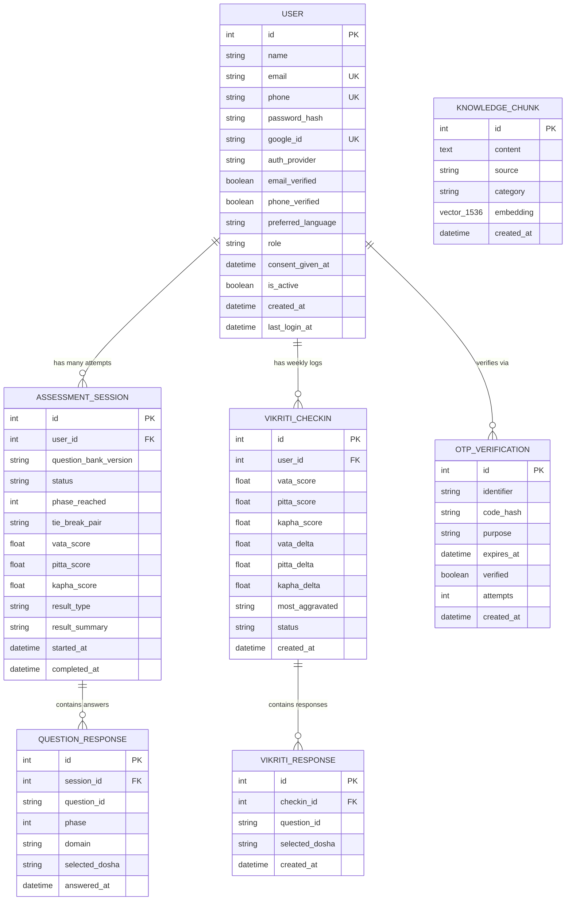

# AYUSHYA (RAG-Veda) — Database Schema & Data Models

> **Comprehensive specifications for PostgreSQL 16 relational tables, SQLModel entity definitions, pgvector embeddings, constraints, and privacy-first architectural design.**

---

## 1. Architectural Design Principles

The AYUSHYA data layer is designed around three strict engineering principles:
1. **PII Decoupling & DPDP Act 2023 Compliance:** Personal identity data (`User`, `OTPVerification`) is stored separately from health/phenotypic evaluation data (`AssessmentSession`, `VikritiCheckin`). This allows health records to be anonymized for research or deleted independently upon user request.
2. **Deterministic Versioning:** Static question banks live in versioned application files (`app/data/prakriti_questions.py`), while `AssessmentSession` records only store the dynamic answers, session timestamps, and computed scores tagged by `question_bank_version = "v1"`.
3. **Hybrid Relational + Vector Storage:** General application entities use standard relational tables, while classical Samhita wisdom is stored in `KnowledgeChunk` using the `pgvector` extension for sub-millisecond semantic retrieval.

---

## 2. Entity-Relationship (ER) Diagram



---

## 3. Table-by-Table Schema Specification

### 3.1 `user` Table
Stores authenticated user accounts and identity providers.

| Column | Type | Constraints | Description |
| :--- | :--- | :--- | :--- |
| `id` | `INTEGER` | `PRIMARY KEY`, Auto-increment | Unique user identifier |
| `name` | `VARCHAR` | Nullable | Full name of the user |
| `email` | `VARCHAR` | `UNIQUE`, `INDEX`, Nullable | Email address for email/password or Google auth |
| `phone` | `VARCHAR` | `UNIQUE`, `INDEX`, Nullable | Phone number for mobile OTP authentication |
| `password_hash` | `VARCHAR` | Nullable | Bcrypt password hash (only for email+password signups) |
| `google_id` | `VARCHAR` | `UNIQUE`, `INDEX`, Nullable | Google OAuth Subject ID |
| `auth_provider` | `VARCHAR` | Default: `'email'` | Provider type: `'email'`, `'phone'`, or `'google'` |
| `email_verified` | `BOOLEAN`| Default: `FALSE` | Email verification flag |
| `phone_verified` | `BOOLEAN`| Default: `FALSE` | Mobile verification flag |
| `preferred_language`| `VARCHAR`| Default: `'en'` | UI language preference: `'en'` or `'hi'` |
| `role` | `VARCHAR` | Default: `'user'` | Access control: `'user'`, `'practitioner'`, or `'admin'` |
| `consent_given_at` | `TIMESTAMP` | Nullable | Timestamp of digital health consent acceptance |
| `is_active` | `BOOLEAN`| Default: `TRUE` | Soft-deletion flag |
| `created_at` | `TIMESTAMP` | Default: `UTC_NOW` | Account registration timestamp |
| `last_login_at` | `TIMESTAMP` | Nullable | Most recent successful login timestamp |

---

### 3.2 `otpverification` Table
Ephemeral OTP records for phone and email verification before or during account creation.

| Column | Type | Constraints | Description |
| :--- | :--- | :--- | :--- |
| `id` | `INTEGER` | `PRIMARY KEY`, Auto-increment | Unique record identifier |
| `identifier` | `VARCHAR` | `INDEX`, Non-null | Destination phone number or email address |
| `code_hash` | `VARCHAR` | Non-null | Salted SHA-256 / bcrypt hash of the 6-digit OTP code |
| `purpose` | `VARCHAR` | Default: `'login'` | Purpose: `'login'`, `'signup'`, `'verify_phone'`, `'verify_email'` |
| `expires_at` | `TIMESTAMP` | Non-null | Expiration timestamp (typically 10 minutes from generation) |
| `verified` | `BOOLEAN` | Default: `FALSE` | Whether the OTP was successfully validated |
| `attempts` | `INTEGER` | Default: `0` | Rate-limiting attempt counter (max 3–5 attempts) |
| `created_at` | `TIMESTAMP` | Default: `UTC_NOW` | Generation timestamp |

---

### 3.3 `assessmentsession` Table
One Prakriti assessment lifecycle. Persists final normalized scores and constitutional classification.

| Column | Type | Constraints | Description |
| :--- | :--- | :--- | :--- |
| `id` | `INTEGER` | `PRIMARY KEY`, Auto-increment | Unique assessment session ID |
| `user_id` | `INTEGER` | `FOREIGN KEY (user.id)`, `INDEX` | Owning user ID |
| `question_bank_version` | `VARCHAR` | Default: `'v1'` | Version identifier of the question bank used |
| `status` | `VARCHAR` | Default: `'in_progress'` | Status: `'in_progress'` or `'completed'` |
| `phase_reached` | `INTEGER` | Default: `1` | Phase indicator: `1` (Foundational) or `2` (Tie-breaker) |
| `tie_break_pair` | `VARCHAR` | Nullable | Specific doshas contesting: `'vata_pitta'`, `'pitta_kapha'`, etc. |
| `vata_score` | `FLOAT` | Nullable | Normalized Vata percentage ($0.0 - 100.0$) |
| `pitta_score` | `FLOAT` | Nullable | Normalized Pitta percentage ($0.0 - 100.0$) |
| `kapha_score` | `FLOAT` | Nullable | Normalized Kapha percentage ($0.0 - 100.0$) |
| `result_type` | `VARCHAR` | Nullable | Dominance: e.g. `'vata_dominant'`, `'pitta_kapha'`, `'tridoshic'` |
| `result_summary` | `TEXT` | Nullable | Compact JSON payload used as structured LLM context |
| `started_at` | `TIMESTAMP` | Default: `UTC_NOW` | Assessment initiation timestamp |
| `completed_at` | `TIMESTAMP` | Nullable | Final completion timestamp |

---

### 3.4 `questionresponse` Table
Individual answers submitted during an `AssessmentSession`.

| Column | Type | Constraints | Description |
| :--- | :--- | :--- | :--- |
| `id` | `INTEGER` | `PRIMARY KEY`, Auto-increment | Unique response ID |
| `session_id` | `INTEGER` | `FOREIGN KEY (assessmentsession.id)`, `INDEX` | Parent assessment session ID |
| `question_id` | `VARCHAR` | Non-null | Identifier from the static question bank (e.g. `'p1_q01'`) |
| `phase` | `INTEGER` | Non-null | Phase number: `1` or `2` |
| `domain` | `VARCHAR` | Nullable | Assessment domain (e.g. `'physical'`, `'physiological'`) |
| `selected_dosha` | `VARCHAR` | Non-null | Chosen dosha affinity: `'vata'`, `'pitta'`, or `'kapha'` |
| `answered_at` | `TIMESTAMP` | Default: `UTC_NOW` | Timestamp of submission |

---

### 3.5 `vikriticheckin` Table
Stores periodic (weekly) pulse check evaluations measuring transient dosha deviation from baseline.

| Column | Type | Constraints | Description |
| :--- | :--- | :--- | :--- |
| `id` | `INTEGER` | `PRIMARY KEY`, Auto-increment | Unique check-in identifier |
| `user_id` | `INTEGER` | `FOREIGN KEY (user.id)`, `INDEX` | Owning user ID |
| `vata_score` | `FLOAT` | Default: `0.0` | Real-time active Vata score |
| `pitta_score` | `FLOAT` | Default: `0.0` | Real-time active Pitta score |
| `kapha_score` | `FLOAT` | Default: `0.0` | Real-time active Kapha score |
| `vata_delta` | `FLOAT` | Default: `0.0` | Positive aggravation variance vs. birth Prakriti ($\Delta V$) |
| `pitta_delta` | `FLOAT` | Default: `0.0` | Positive aggravation variance vs. birth Prakriti ($\Delta P$) |
| `kapha_delta` | `FLOAT` | Default: `0.0` | Positive aggravation variance vs. birth Prakriti ($\Delta K$) |
| `most_aggravated` | `VARCHAR` | Default: `'vata'` | Primary active imbalance: `'vata'`, `'pitta'`, or `'kapha'` |
| `status` | `VARCHAR` | Default: `'in_progress'` | Status: `'in_progress'` or `'completed'` |
| `created_at` | `TIMESTAMP` | Default: `UTC_NOW` | Check-in timestamp |

---

### 3.6 `vikritiresponse` Table
Individual answers recorded during a weekly `VikritiCheckin`.

| Column | Type | Constraints | Description |
| :--- | :--- | :--- | :--- |
| `id` | `INTEGER` | `PRIMARY KEY`, Auto-increment | Unique response identifier |
| `checkin_id` | `INTEGER` | `FOREIGN KEY (vikriticheckin.id)`, `INDEX` | Parent Vikriti check-in ID |
| `question_id` | `VARCHAR` | Non-null | Weekly question identifier (e.g. `'v_q01'`) |
| `selected_dosha` | `VARCHAR` | Non-null | Selected aggravated dosha |
| `created_at` | `TIMESTAMP` | Default: `UTC_NOW` | Timestamp of answer |

---

### 3.7 `knowledgechunk` Table (Vector Database via `pgvector`)
Stores verified classical treatise excerpts and guidelines for RAG retrieval.

| Column | Type | Constraints | Description |
| :--- | :--- | :--- | :--- |
| `id` | `INTEGER` | `PRIMARY KEY`, Auto-increment | Chunk identifier |
| `content` | `TEXT` | Non-null | Excerpt text from classical treatise |
| `source` | `VARCHAR` | Non-null | Source treatise (e.g. `'charaka_sutra_ch6'`, `'diet_vata'`) |
| `category` | `VARCHAR` | Non-null | Category: `'diet'`, `'lifestyle'`, `'herb'`, `'general'` |
| `embedding` | `VECTOR(1536)` | Custom SQL Column | 1536-dimensional vector embedding |
| `created_at` | `TIMESTAMP` | Default: `UTC_NOW` | Creation timestamp |

---

## 4. Vector Search & Similarity Query

Semantic retrieval on `knowledgechunk` uses **Cosine Distance** (`<=>` operator in `pgvector`):

```sql
SELECT id, content, source, category, 
       1 - (embedding <=> :query_embedding) AS similarity_score
FROM knowledgechunk
WHERE category = :target_category
ORDER BY embedding <=> :query_embedding ASC
LIMIT 4;
```

* **Index Type:** IVFFlat / HNSW index for sub-10ms approximate nearest neighbor (ANN) retrieval over large classical text corpora.
