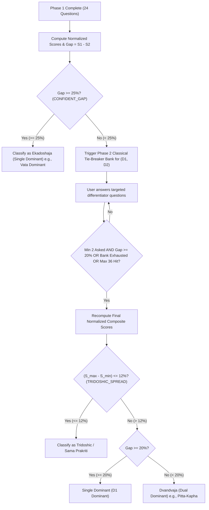

# AYUSHYA — Dosha Scoring Engine & Clinical Defense Guide

> **A rigorous technical and clinical reference explaining the mathematics of Prakriti & Vikriti scoring, real-world Ayurvedic clinical correlation, and bulletproof defense scripts for hackathon jury Q&A.**

---

## 1. Clinical Grounding & Classical Foundations

### 1.1 The Vedic Science: Prakriti vs. Vikriti
In classical Ayurveda (*Charaka Samhita, Vimana Sthana, Chapter 8*), the clinical examination of any individual is rooted in the **Ten-Fold Examination (*Dashavidha Pariksha*)**. 

The treatise explicitly treats two parameters as distinct entities:
1. **Prakriti (प्रकृति - Deha Prakriti):** The congenital, immutable biological phenotype established at the moment of conception (*Shukra-Shonita Samyoga*) by the dominant doshas of the parents, maternal diet, and gestational environment.
2. **Vikriti (विकृति - Dosha Vitiation):** The transient, pathological or sub-clinical state of dosha imbalance present *right now*, provoked by unwholesome diet (*Mithya Ahara*), stressful lifestyle (*Mithya Vihara*), circadian disruption, and weather/seasonal changes (*Kala/Parinama*).

```
   CONGENITAL BASELINE (Prakriti)            TRANSIENT IMBALANCE (Vikriti)
+------------------------------------+   +------------------------------------+
|  - Inherent DNA / Phenotype        |   |  - Real-time physiological shifts  |
|  - Lifetime bone frame, sclera     |   |  - Digestion gas, sleep debt       |
|  - Immutable baseline reference    |   |  - Changes week-to-week            |
+-----------------+------------------+   +-----------------+------------------+
                  |                                        |
                  \-------------------  -------------------/
                                      \/
                     COMPUTED CLINICAL DELTA (Δ)
                 "How far has the user drifted from
                   their natural biological home?"
```

---

## 2. Low-Level Prakriti Scoring Engine (`prakriti_scoring.py`)

The Prakriti scoring engine is a **pure, deterministic, rule-based mathematical matrix** completely decoupled from database latency and LLM non-determinism.

### 2.1 Question Bank Architecture
* **Phase 1 (Foundational Assessment):** 24 questions evenly distributed across four classical diagnostic domains:
  1. **Physical Anatomy:** Skeletal frame, joint prominence, skin texture, hair density, eyes/sclera.
  2. **Physiological Metabolism:** Basal digestive power (*Agni*), bowel regularity (*Koshtha*), thirst, perspiration, temperature tolerance.
  3. **Psychological Temperament:** Memory retention (*Dhi, Dhriti, Smriti*), stress reactions, emotional triggers, sleep depth (*Nidra*).
  4. **Behavioral Patterns:** Speech cadence, financial tendencies, pace of walking and execution.
* Every option strictly maps to one of the three Doshas: $\text{Vata } (V)$, $\text{Pitta } (P)$, or $\text{Kapha } (K)$.

---

### 2.2 Mathematical Score Calculation
Let $C_v, C_p, C_k$ be the count of answers selected for Vata, Pitta, and Kapha respectively:
$$\text{Total Answered } (N) = C_v + C_p + C_k$$

Normalized percentages are calculated as:
$$\text{Score}_d = \text{round}\left( \frac{C_d}{N} \times 100, \, 2 \right) \quad \text{for } d \in \{v, p, k\}$$

The doshas are ranked in descending order:
$$\text{Ranked} = [ (D_1, S_1), \, (D_2, S_2), \, (D_3, S_3) ] \quad \text{where } S_1 \ge S_2 \ge S_3$$

The primary score differential ($\text{Gap}$) between the top two doshas is:
$$\text{Gap} = S_1 - S_2$$

---

### 2.3 Algorithmic Classification Rules & Thresholds



#### Exact Constants in Code:
* `CONFIDENT_GAP = 25%`: If the top dosha leads by 25% or more at the end of Phase 1, diagnosis is conclusive without tie-breakers.
* `TIEBREAK_STOP_GAP = 20%`: In Phase 2, as soon as targeted tie-breakers widen the gap to $\ge 20\%$, the assessment finishes early to prevent user fatigue.
* `MIN_TIEBREAK_BEFORE_CHECK = 2`: Minimum 2 tie-breaker questions must be answered before evaluating the stop gap.
* `TRIDOSHIC_SPREAD = 12%`: If the total variance between the highest and lowest dosha ($S_1 - S_3$) is $\le 12\%$ (e.g., $36\% - 33\% - 31\%$), it is categorized as **Tridoshic (Sama Prakriti)**.
* Otherwise, top doshas within 20% are classified into canonical dual pairs:
  * $\text{Vata} + \text{Pitta} \implies$ `vata_pitta`
  * $\text{Pitta} + \text{Kapha} \implies$ `pitta_kapha`
  * $\text{Vata} + \text{Kapha} \implies$ `vata_kapha`

---

## 3. Low-Level Vikriti Engine & Aggravation Delta ($\Delta$)

The Vikriti engine does **not** treat weekly scores in isolation. Doing so is the #1 mistake of amateur wellness apps.

### 3.1 The Clinical Scenario (Why Raw Score Fails)
Consider a user with a natural **Kapha-Dominant Prakriti**:
* **Birth Prakriti Baseline:** $\text{Kapha} = 55\%, \, \text{Pitta} = 30\%, \, \text{Vata} = 15\%$

This week, due to erratic travel, irregular sleep, and cold weather, the user takes the 10-question Vikriti pulse check:
* **Raw Vikriti Scores:** $\text{Kapha} = 45\%, \, \text{Vata} = 35\%, \, \text{Pitta} = 20\%$

* **The Amateur Mistake:** A naive app looks at the highest raw score ($\text{Kapha} = 45\%$) and falsely tells the user: *"Your Kapha is aggravated! Avoid heavy foods!"*
* **The Clinical Truth:** Kapha actually *dropped* from 55% to 45%. Meanwhile, Vata surged from $15\% \to 35\%$ (**a massive $+20\%$ aggravation!**). The user is experiencing dry skin, insomnia, and bloating. Telling them to reduce Kapha will aggravate their Vata even further and cause clinical harm!

### 3.2 The Mathematical Aggravation Delta Formula (`compute_aggravation`)
AYUSHYA computes the exact displacement vector ($\Delta$) from the user's congenital baseline:

$$\Delta_d = \text{round}\left( \text{Score}_{\text{Vikriti}, d} - \text{Score}_{\text{Prakriti}, d}, \, 2 \right) \quad \text{for } d \in \{v, p, k\}$$

$$\text{Most Aggravated Dosha} = \arg\max_{d \in \{v, p, k\}} (\Delta_d)$$

* If $\Delta_v = +20\%$, **Vata is elevated** over baseline.
* The system activates the Level 2 Dynamic Adaptation banner:  
  * *"Your Vata is currently elevated (+20% vs baseline). Your weekly diet plan has been customized to pacify this."*

---

## 4. Real-World Ayurvedic Clinical Practice vs. AYUSHYA

| Parameter | Real-World Vaidya in Clinic | AYUSHYA Digital Platform | Clinical Validation & Defense |
| :--- | :--- | :--- | :--- |
| **Diagnostic Modality** | **Trividha Pariksha:**<br>1. *Darshana* (Observation)<br>2. *Sparshana* (Palpation & Nadi)<br>3. *Prashna* (Questioning) | Standardized **Prashna Pariksha** + visual visual choice cards simulating *Darshana*. | In classical literature (*Charaka Sutrasthana Ch. 10*), *Prashna Pariksha* (questioning anamnesis) covers 80%+ of constitutional assessment traits. |
| **Pulse Examination (Nadi)** | Subjective finger-feel of arterial expansion at radial artery by an experienced Vaidya. | Replaced by **10-question weekly symptomatic Vikriti check-in** capturing real-time physiological markers. | Nadi fluctuates with recent food, emotion, and bath. Symptom-based Vikriti tracking provides a standardized, reproducible baseline without inter-examiner bias. |
| **Ambiguity Resolution** | Doctor probes deeper with clarifying questions when signs conflict. | **Phase 2 Classical Tie-Breaker Bank** dynamically triggers targeted differentiator questions. | Mirror-matches real clinical consultations: instead of overwhelming patients with 50 questions upfront, ask 24, then branch only if ambiguous. |
| **Reproducibility** | Two different doctors can give slightly varying opinions based on personal intuition. | **100% Deterministic Mathematical Matrix:** Same answers always yield identical clinical scores. | Eliminates human subjective bias while maintaining clinical auditability. |

---

## 5. Master Defense Strategy for Hackathon Presentation / Q&A

Here are the exact questions judges will ask during your SIH presentation, and the precise, authoritative answers to defend your project.

---

### Question 1: "Why did you use a rule-based algorithm instead of an advanced LLM (GPT-4 / Llama-3) to predict Prakriti?"

#### 🎙️ The Winning Rebuttal:
> *"Judges, that was a deliberate and vital medical architecture decision.*
> 
> *In clinical diagnostics, **non-deterministic black-box LLMs are dangerous**. If a patient inputs identical symptoms today and tomorrow, an LLM can hallucinate, change its reasoning, and assign a completely different Prakriti. Furthermore, an LLM cannot be audited mathematically by the Ministry of Ayush.*
> 
> *AYUSHYA uses a **Hybrid AI Architecture**:*
> 1. *The **Diagnosis is 100% Deterministic**: our rule-based matrix guarantees reproducibility, zero hallucination, and explainable percentages.*
> 2. *The **LLM and RAG are used where they belong**: retrieving, synthesizing, and summarizing citation-backed lifestyle and dietary advice from classical texts.*
> 
> *This separation ensures medical safety and clinical explainability."*

---

### Question 2: "How do you handle subjective bias? What if a user lies or doesn't know their own body accurately?"

#### 🎙️ The Winning Rebuttal:
> *"That is an established challenge in all questionnaire-based medicine, including CCRAS protocols. We mitigated this with three structural safeguards:*
> 
> 1. ***Cross-Domain Triangulation:*** *We don't ask one question about a trait. We test physical frame, physiological digestion, and psychological temperament separately. If a user thinks they are Pitta but has dry Vata joints and cold Vata tolerance, the cross-domain math balances out the error.*
> 2. ***Visual Anchor Cards:*** *Instead of vague text like 'Are you thin?', our options provide visual illustrations representing anatomical bone structures, eliminating subjective misunderstanding.*
> 3. ***Phase 2 Classical Tie-Breakers:*** *If user hesitation creates a close tie between two doshas, the system dynamically fires high-contrast differentiator questions to resolve the ambiguity."*

---

### Question 3: "Why do you subtract Prakriti from Vikriti? Why not just show the weekly score?"

#### 🎙️ The Winning Rebuttal:
> *"Because in Ayurveda, **absolute numbers without a baseline reference lead to wrong medical advice**.*
> 
> *If a naturally Kapha-dominant person (60% Kapha baseline) undergoes severe work stress and lack of sleep, their Vata might spike from 15% to 35%, while Kapha drops to 45%.*
> 
> *If we only look at the raw weekly score (45% Kapha vs 35% Vata), an app would falsely tell them: 'Your Kapha is highest, stop eating ghee and fast!' But in reality, their Vata just surged by +20% over baseline! Telling them to fast will cause severe Vata exhaustion.*
> 
> *By calculating $\Delta = \text{Vikriti} - \text{Prakriti}$, AYUSHYA catches the true biological drift and prescribes the correct pacifying diet."*

---

### Question 4: "Can a software tool truly replace a real Ayurvedic doctor's Nadi Pariksha (Pulse diagnosis)?"

#### 🎙️ The Winning Rebuttal:
> *"No, and AYUSHYA is explicitly designed **not to replace a physician**, but to serve as a **continuous preventive health companion**.*
> 
> *A patient visits a Vaidya once every few months. But health happens every single day—at every meal, every bedtime, and every workout. AYUSHYA empowers the citizen with daily circadian awareness (*Dinacharya*) and seasonal resilience (*Ritucharya*).*
> 
> *When severe imbalances are detected, AYUSHYA's built-in triage protocols advise the user to seek certified clinical consultation, directly bridging the public into the formal Ayush healthcare system."*

---

### Question 5: "What classical Ayurvedic literature supports your question bank and scoring?"

#### 🎙️ The Winning Rebuttal:
> *"Our question bank and scoring parameters are directly operationalized from:*
> 1. ***Charaka Samhita, Vimana Sthana, Chapter 8 (Roga Bhishagjitiya Adhyaya):*** *The classical definition of Deha Prakriti and Dashavidha Pariksha.*
> 2. ***Sushruta Samhita, Sharira Sthana, Chapter 4:*** *Anatomical and metabolic dosha attributes.*
> 3. ***Ashtanga Hridaya, Sutrasthana, Chapter 1 & 2:*** *Daily circadian chronobiology (Dinacharya) and seasonal transition rules (Ritucharya).*
> 4. ***CCRAS Standardized Prakriti Assessment Formats:*** *Published by the Ministry of Ayush, Government of India."*
