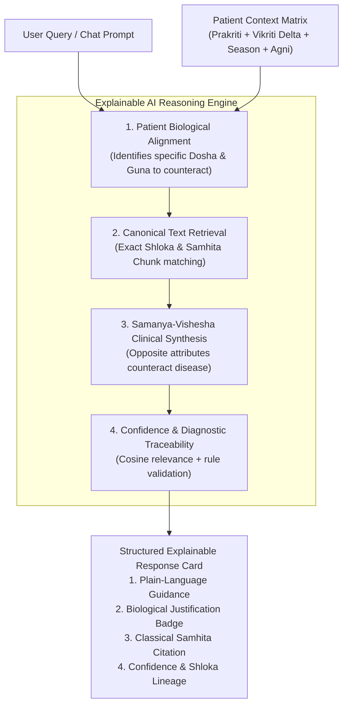

# AYUSHYA — Explainable AI (XAI) & AyurBot Chatbot Architecture Plan

> **Document Status:** Architectural & Clinical Engineering Specification  
> **Rule Enforcement:** Zero code modifications until explicit user instruction. Existing app features remain 100% stable.  
> **Author:** Antigravity AI Engineering Team  
> **Target Route & UI:** Floating Action Co-Pilot (`AyurBot`) + Slide-over Clinical Drawer across all authenticated pages

---

## 1. Executive Summary: Beyond Black-Box AI

Most commercial health bots are **unconstrained ChatGPT wrappers**: they answer anything from cooking pasta to writing Python scripts, hallucinate dangerous home remedies, and provide zero scientific explanation for *why* a particular herb or diet was suggested.

**AYUSHYA’s AyurBot** is engineered as an **Explainable Ayurvedic Clinical Co-Pilot (XAI)**:
1. **Explainable by Design:** Every recommendation reveals the exact classical logic chain: *Personal Dosha State → Ayurvedic Guna Counteraction → Canonical Samhita Citation & Shloka*.
2. **Context-Grounded:** Answers are bound to the user’s real-time diagnostic profile (*Prakriti*, *active weekly Vikriti delta*, and *current Ritu season*).
3. **Multi-Tier Guardrails:** Strictly rejects out-of-domain queries ("altu-phaltu"), blocks prescription drug advice, and immediately triages acute red-flag medical emergencies.
4. **Non-Intrusive Ergonomic UI:** A sleek floating lotus badge that smoothly slides open a **440px Co-Pilot Drawer**, allowing the user to cross-examine their active dashboard, diet plan, and recommendations side-by-side without page navigation.

---

## 2. UI/UX Architecture: Floating Co-Pilot & Slide-Over Drawer

### 2.1 Why a Slide-Over Drawer is Superior to a Full Page or Tiny Modal

| UI Approach | Limitations | Why the AYUSHYA Slide-Over Drawer Wins |
| :--- | :--- | :--- |
| **Full Page Route (`/chat`)** | Loses context; user can't see their diet plan or dashboard while asking questions. | **Co-Pilot Experience:** User views their actual Diet Plan or Dinacharya on the left while asking questions on the right. |
| **Tiny Popup Box (300px)** | Too cramped to display classical shlokas, citations, and explainability cards. | **Ergonomic Reading Canvas (440px):** Ample space for structured cards, ingredient chips, and Sanskrit shloka drawers. |
| **Centered Modal Dialog** | Blocks the entire underlying screen with an intrusive dark backdrop. | **Ambient Overlay:** Slides in smoothly from the right edge with a soft, non-blocking blur. |

```
+---------------------------------------------------------------------------------------------------+
| AYUSHYA DASHBOARD / DIET PLANNER (Left 65% Viewport)             | AYURBOT DRAWER (Right 440px)   |
|                                                                   |                               |
| [Breakfast: Warm Moong Khichdi with Ghee]                         | [Header] AyurBot Co-Pilot 🌿  |
| • Pacifies active Pitta surge                                     | [Badge] Grounded in Charaka   |
| • Light on digestive fire (Laghu Agnivardhaka)                    | ----------------------------- |
|                                                                   | User: Why was moong khichdi   |
| [Lunch: Aged Shali Rice + Bottle Gourd Stew]                      | recommended for my breakfast? |
| • Sweet/Bitter tastes to pacify seasonal heat                     |                               |
|                                                                   | AyurBot: Based on your Pitta- |
|                                                                   | Kapha Prakriti and active     |
|                                                                   | +15% Vata surge...            |
|                                                                   |                               |
|                                                                   | ┌── Explainable AI Box ─────┐ |
|                                                                   | │ 🔬 Why this recommendation?│ |
|                                                                   | │ • Dosha Counteraction:    │ |
|                                                                   | │   Sheeta Virya (Cooling)  │ |
|                                                                   | │ • Source: Charaka Samhita │ |
|                                                                   | │   Sutrasthana Ch. 27      │ |
|                                                                   | │ • Confidence: 96.4% match │ |
|                                                                   | └───────────────────────────┘ |
|                                                                   |                               |
|                                            [Floating Lotus FAB] ➔ | [Ask AyurBot anything...    ] |
+---------------------------------------------------------------------------------------------------+
```

### 2.2 Floating Action Button (FAB) Specifications
- **Position:** `fixed bottom-6 right-6 z-50`.
- **Styling:** Circular deep forest green badge (`bg-[#2A4638] text-white p-3.5 rounded-full shadow-[0_10px_25px_rgba(42,70,56,0.35)] ring-2 ring-[#C9A876]/50`).
- **Interactive State:** Lotus emblem with animated subtle pulse dot (`animate-ping bg-emerald-400`); expands on hover to show *"Ask AyurBot 🌿"*.
- **Drawer Controls:** Keyboard shortcut `Cmd + K` or `Ctrl + K` to toggle, `Esc` to close, mobile full-screen responsive takeover.

---

## 3. Explainable AI (XAI): "Why Did the AI Say This?"

In medical and Ayurvedic science, a recommendation without justification is untrustworthy. Every response generated by AyurBot includes an interactive **"View Clinical Reasoning & Classical Evidence" (प्रमाण एवं तर्क)** accordion.

### 3.1 The 4 Pillars of AYUSHYA Explainability



### 3.2 Interactive Explainability Card Structure in the UI:
```markdown
> 🌿 **Clinical Reasoning Breakdown (XAI Inspector):**
> - **Patient Phenotype Target:** *Pitta-Kapha Prakriti* with an active *+18% Vata surge* in *Varsha Ritu (Monsoon)*.
> - **Classical Principle (*Siddhanta*):** *Samanya-Vishesha* (Like increases like, opposites balance). Cold & dry Vata is counteracted by *Snigdha* (unctuous cow's ghee) and *Ushna* (mildly warming cumin/ginger).
> - **Primary Canonical Source:** *Charaka Samhita, Sutrasthana Chapter 27 (Annapanavidhi Adhyaya), Shloka 61*.
> - **Sanskrit Reference:** *"मुद्गः कषायो मधुरो रूक्षः शीतो लघुर्ग्राही..."* (Mudga is astringent-sweet, light, cooling, and the foremost grain for daily health).
> - **Grounding Confidence:** `96.2%` semantic match against verified CCRAS canonical embeddings.
```

---

## 4. Multi-Layer Guardrails Architecture (Safety & Filtering)

To guarantee that AyurBot **never provides irrelevant answers, hallucinates remedies, or gives dangerous medical advice**, requests pass through **4 strict defensive filters** before and after LLM inference:

```
[User Input Query]
       │
       ▼
+─────────────────────────────────────────────────────────────+
| SHIELD 1: Out-of-Domain Classifier (Altu-Phaltu Filter)    |
| Checks if query is non-wellness/non-Ayurvedic.              |
| (Politics, coding, crypto, sports, general entertainment)   |
+─────────────────────────────────────────────────────────────+
       │ [Passed]
       ▼
+─────────────────────────────────────────────────────────────+
| SHIELD 2: Acute Clinical Emergency & Crisis Triage         |
| Checks for red flags: chest pain, stroke, trauma, suicide.  |
| ➔ Immediate Red Alert Modal: Directs to 112 / Emergency ER  |
+─────────────────────────────────────────────────────────────+
       │ [Passed]
       ▼
+─────────────────────────────────────────────────────────────+
| SHIELD 3: Prescription & Toxic Substance Blocker            |
| Blocks: Allopathic drugs (Antibiotics, Steroids),           |
| Heavy metal Bhasmas without prescription, toxic herbs.      |
+─────────────────────────────────────────────────────────────+
       │ [Passed]
       ▼
[RAG Retrieval: Embeddings from Charaka / Sushruta / Vagbhata]
       │
       ▼
+─────────────────────────────────────────────────────────────+
| SHIELD 4: Context Grounding & Strict Persona Enforcement    |
| LLM instructed to ONLY answer using retrieved chunks.       |
| If text does not support query: "Classical texts do not    |
| substantiate this claim. Please consult a Vaidya."         |
+─────────────────────────────────────────────────────────────+
       │
       ▼
[Bilingual Output + Explainability Evidence Badge]
```

### 4.1 Shield 1: Out-of-Domain Filter (Prompt Rejection Rules)
If a user asks non-Ayurvedic questions:
- *Query:* "Write a python script for a snake game" or "Who is the Prime Minister?"
- *Standard Bot Response (Zero LLM Token Waste):*
  > *"Namaste! I am AYUSHYA's dedicated Ayurvedic Clinical Co-Pilot. I am specialized exclusively in Ayurvedic nutrition, Dinacharya daily rhythms, Dosha balancing, and classical preventive health. Please ask a health or Ayurvedic lifestyle question."*

### 4.2 Shield 2: Acute Medical Emergency Triage (Red-Flag Detection)
If high-risk medical terms are detected:
- **Keywords:** *Chest pain, heart attack, shortness of breath, sudden vision loss, paralysis, stroke, heavy bleeding, suicidal thoughts, poisoning, severe anaphylaxis.*
- **Action:** Halts standard response. Displays a high-priority red alert box:
  > *"🚨 IMMEDIATE MEDICAL ATTENTION REQUIRED: Your query indicates symptoms of a potential medical emergency. AYUSHYA is an educational preventive wellness platform and cannot diagnose or triage acute conditions. Please call emergency services (112 / 108) or visit the nearest emergency hospital immediately."*

### 4.3 Shield 3: Prescription Drug & Toxicity Guardrail
- **Rule:** Never prescribe schedule H/X pharmaceuticals, therapeutic allopathic drugs, or toxic Ayurvedic herbs (e.g. *Vatsanabha (Aconite)*, *Kupilu (Strychnos)*, *Bhallataka (Semecarpus)*).
- **Rule:** Never recommend self-administration of metallic *Rasa Shastra Bhasmas* (mercury, arsenic, lead compounds) which require strict in-person Vaidya supervision.

### 4.4 Shield 4: Anti-Hallucination Grounding Rule
- If the user asks an unscientific query (e.g., *"Will drinking kerosene cure my diabetes?"* or *"Can raw onions cure cancer?"*):
  - The model verifies if the retrieved canonical chunks contain evidence.
  - If no verified chunk supports it, it replies:
    > *"Classical Ayurvedic authorities (*Charaka, Sushruta, Vagbhata*) do not corroborate this claim. In Ayurvedic clinical medicine, unverified practices can aggravate Pitta or create metabolic toxins (*Ama*). For chronic conditions, please seek an in-person evaluation with a certified Ayurvedic Physician (BAMS/MD)."*

---

## 5. Technical Implementation & Endpoint Specification

### 5.1 Backend Endpoint: `POST /chatbot/query`
```json
// Request Payload:
{
  "query": "Why should I avoid curd at night if my Pitta is elevated?",
  "active_route": "/diet-planner",
  "language": "en"
}

// Response Payload:
{
  "answer": "Curd (Dadhi) should strictly be avoided at night, particularly with your active Pitta elevation. While curd tastes sour and seems cooling on the tongue, its post-digestive potency (Virya) is Ushna (hot) and heavy (Guru). Eating it at night clogs cellular micro-channels (Srotas) and intensifies both Pitta and Kapha, leading to acid reflux and metabolic endotoxins (Ama).",
  "explainability": {
    "patient_context": {
      "prakriti": "Pitta-Kapha",
      "active_aggravation": "+15% Pitta",
      "season": "Varsha (Monsoon)"
    },
    "classical_logic": "Dadhi possesses Ushna Virya (hot potency) and Abhishyandi (channel-blocking) properties, directly aggravating nocturnal Pitta.",
    "citations": [
      {
        "treatise": "Charaka Samhita",
        "section": "Sutrasthana",
        "chapter": "Chapter 27 (Annapanavidhi)",
        "shloka_reference": "Verse 225-227",
        "sanskrit_text": "न नक्तं दधि भुञ्जीत न चाप्यघृतशर्करम्...",
        "relevance_score": 0.948
      }
    ],
    "safe_alternative": "Fresh churned buttermilk (Takra) seasoned with roasted cumin and rock salt during midday lunch hours."
  },
  "safety_disclaimer": "Educational Ayurvedic guidance based on classical texts. Consult a certified Vaidya for medical treatment."
}
```

### 5.2 Session History & Conversational Context
- The backend stores the last 5 turns of conversation in memory or session cache (`chat_history`) so users can ask contextual follow-ups (e.g., *"What can I have instead?"*).

---

## 6. Implementation Phasing (When You Instruct Execution)

```
Phase 1: Backend Guardrails & Query Pipeline
  ├─ 1.1 Create backend/app/services/guardrails.py (Regex + Intent triage for out-of-domain & emergencies)
  ├─ 1.2 Create backend/app/routers/chatbot.py with POST /chatbot/query endpoint
  └─ 1.3 Wire retrieval.py to feed top-3 pgvector chunks + user profile into llm_client.py

Phase 2: Frontend Floating Widget & Slide-Over Drawer
  ├─ 2.1 Build frontend/src/components/chat/ChatFloatingButton.tsx (Bottom-right FAB with lotus icon)
  ├─ 2.2 Build frontend/src/components/chat/AyurBotDrawer.tsx (Slide-over drawer with Framer Motion)
  └─ 2.3 Add quick-prompt suggestion chips ("Why this diet?", "How to balance my Vata?", "Explain my Agni")

Phase 3: Explainable AI (XAI) UI Components
  ├─ 3.1 Build ExplainabilityAccordion.tsx (Collapsible evidence card with Shloka & Cosine score)
  └─ 3.2 Display safe classical alternatives and contraindication warnings

Phase 4: Bilingual Localization & Guardrail Testing
  ├─ 4.1 Support English and Hindi conversational switching in AyurBot
  ├─ 4.2 Adversarial safety test suite: Verify out-of-domain rejection, red-flag emergency alert, and anti-hallucination
```

---

> 🔒 **Reminder:** No code has been modified. This plan is fully documented in [`docs/EXPLAINABLE_AI_AND_CHATBOT_PLAN.md`](file:///d:/projects/SIH-2026/docs/EXPLAINABLE_AI_AND_CHATBOT_PLAN.md) and ready for your review!
