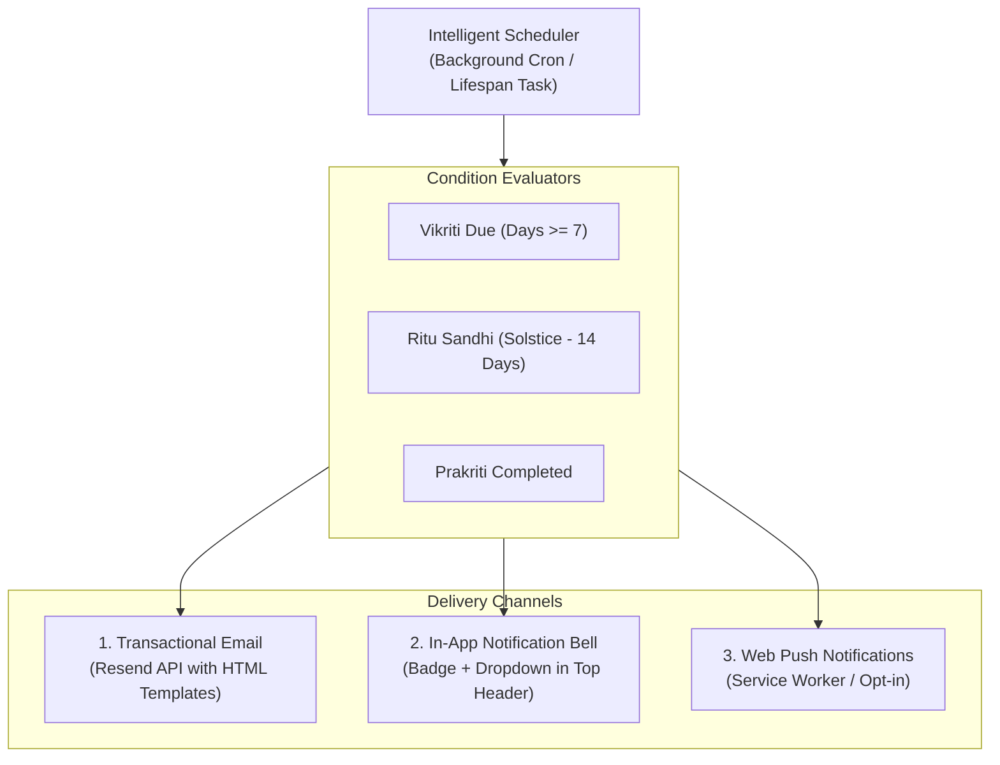

# AYUSHYA — Intelligent Notification & User Re-Engagement System Plan

> **Document Status:** Architectural & Engineering Specification  
> **Rule Enforcement:** Zero code modifications until explicit user instruction. Existing app features remain 100% stable.  
> **Author:** Antigravity AI Engineering Team  
> **Target Services:** `backend/app/services/notifications/`, `backend/app/services/email.py`, `frontend/src/components/AppShell.tsx`

---

## 1. Executive Summary & Why Notifications Matter in AYUSHYA

In conventional health apps, users take an intake quiz once, receive a static PDF or generic advice, and never return (**85%+ 30-day drop-off**). 

In authentic Ayurveda:
- **Prakriti (Birth Constitution)** is lifelong and immutable.
- **Vikriti (Current Imbalance)** fluctuates constantly based on sleep deprivation, cognitive stress, travel, and climatic shifts.
- If a user does not check in weekly, their dynamic diet and circadian regimen become stale and misaligned with their actual biological state.

The **AYUSHYA Intelligent Notification System** creates an automated, medically grounded re-engagement loop that transforms a one-off assessment into an active **weekly wellness companion**.

---

## 2. The 4 Core Notification Triggers (Kya-Kya Notify Kar Sakte Hain?)

Beyond just weekly Vikriti check-ins, the system supports **4 distinct clinical triggers**:

```
+---------------------------------------------------------------------------------------------------+
|                                 AYUSHYA NOTIFICATION MATRIX                                       |
+---------------------------------------------------------------------------------------------------+
| 1. WEEKLY VIKRITI PULSE CHECK (The Primary Retention Loop)                                         |
| • Frequency: Every 7 days from user's last check-in (e.g., Sunday 08:30 AM local time)             |
| • Objective: Calculate active Dosha Delta (Δ) and dynamically adjust the week's diet & sleep      |
| • Dynamic Content: Days since last check-in + preview of how stress/weather may have shifted Doshas|
| • 1-Click CTA: "Take 2-Minute Pulse Check" (Deep-links directly to /vikriti)                      |
+---------------------------------------------------------------------------------------------------+
| 2. RITU SANDHI SEASONAL JUNCTION ALERTS (14-Day Classical Transition Warning)                     |
| • Frequency: Sent twice a year, 7–14 days before a major solstice or seasonal shift                |
| • Objective: Implement Charaka Samhita's gradual diet tapering rule (Padamshika Krama)            |
| • Example Alert: "Monsoon (Varsha) is transitioning into Autumn (Sharad) — Beware of Pitta Surge!" |
| • Guidance: Reduce sour/fermented foods, introduce bitter ghee, and prepare for seasonal detox    |
+---------------------------------------------------------------------------------------------------+
| 3. POST-PRAKRITI ASSESSMENT ONBOARDING DOSSIER                                                    |
| • Frequency: Immediate trigger upon completing 24-question assessment                              |
| • Content: Congratulatory email with verified Phenotype badge (e.g. Pitta-Kapha)                   |
| • Direct Delivery: Embedded summary + 1-click link to view & download official A4 PDF report     |
+---------------------------------------------------------------------------------------------------+
| 4. CIRCADIAN HABIT MILESTONE & WEEKLY HEALTH DIGEST                                               |
| • Frequency: Optional bi-weekly / monthly digest                                                  |
| • Content: "Your Dosha Trajectory: Pitta pacified by 12% this month!" + Recipe of the Week        |
| • Motivation: Reinforces adherence to Brahma Muhurta awakening and Ardha-Shakti exercise limits   |
+---------------------------------------------------------------------------------------------------+
```

---

## 3. Email Template Architecture (Powered by Resend)

Our backend already has the foundational **Resend SDK** integrated in [`backend/app/services/email.py`](file:///d:/projects/SIH-2026/backend/app/services/email.py). 

We will expand this with a dedicated, mobile-responsive **Ayurvedic Newsletter Template Engine**:

### 3.1 Design System for Notification Emails
- **Header:** Deep forest green `#2A4638` with gold logo seal `AYUSHYA — Ayurveda, Personalized`.
- **Background Canvas:** Warm soothing cream `#F6F1E7`.
- **Card Container:** Pure white `#FFFFFF` with soft 16px rounded corners.
- **Accents:** Vata Blue (`#6B8FB5`), Pitta Amber (`#D89A4C`), Kapha Green (`#6B9E6B`).
- **Typography:** Clean, legible sans-serif with bold callout stat boxes.
- **Footer:** 1-click unsubscribe preference link, DPDP Act 2023 privacy notice, and clinical disclaimer.

### 3.2 Sample Weekly Vikriti Reminder Email Template

```html
<!-- Subject: 🌿 Your Weekly Ayurvedic Pulse Check is Due (Keep Your Diet Aligned) -->
<table width="100%" bgcolor="#F6F1E7" cellpadding="0" cellspacing="0">
  <tr>
    <td align="center" style="padding: 30px 10px;">
      <table width="520" bgcolor="#FFFFFF" style="border-radius: 16px; overflow: hidden; box-shadow: 0 4px 20px rgba(0,0,0,0.06);">
        <!-- Header -->
        <tr bgcolor="#2A4638">
          <td align="center" style="padding: 28px 20px;">
            <h1 style="color: #F6F1E7; font-size: 22px; margin: 0; letter-spacing: 2px;">AYUSHYA</h1>
            <p style="color: #C9A876; font-size: 11px; margin: 4px 0 0; text-transform: uppercase; letter-spacing: 1px;">Weekly Dynamic Wellness Loop</p>
          </td>
        </tr>
        <!-- Content -->
        <tr>
          <td style="padding: 32px 28px; color: #1F2A24;">
            <h2 style="font-size: 18px; color: #2A4638; margin: 0 0 12px;">Namaste {user_name},</h2>
            <p style="font-size: 14px; line-height: 22px; color: #526257; margin: 0 0 20px;">
              Your congenital constitution (<strong>{prakriti_type}</strong>) remains steady, but sleep, work stress, and seasonal weather shift your internal doshas every week.
            </p>
            <!-- Status Card -->
            <div style="background-color: #F8F5EE; border-left: 4px solid #D89A4C; border-radius: 8px; padding: 16px; margin-bottom: 24px;">
              <p style="margin: 0; font-size: 13px; color: #2A4638; font-weight: 600;">
                ⏳ Last checked: <strong>{days_ago} days ago</strong>
              </p>
              <p style="margin: 6px 0 0; font-size: 12px; color: #6D7D72;">
                Complete a 2-minute pulse check to unlock this week's customized meal plans, bedtime rituals, and exercise intensity.
              </p>
            </div>
            <!-- CTA Button -->
            <table width="100%" cellpadding="0" cellspacing="0">
              <tr>
                <td align="center" style="padding: 10px 0 24px;">
                  <a href="{checkin_magic_url}" style="background-color: #2A4638; color: #F6F1E7; font-size: 14px; font-weight: 600; padding: 14px 32px; text-decoration: none; border-radius: 9999px; display: inline-block; box-shadow: 0 4px 12px rgba(42,70,56,0.25);">
                    Take 2-Min Vikriti Check-in →
                  </a>
                </td>
              </tr>
            </table>
            <!-- Footer Note -->
            <hr style="border: none; border-top: 1px solid #EAE4D6; margin: 20px 0;" />
            <p style="font-size: 11px; color: #8C9A90; text-align: center; line-height: 16px; margin: 0;">
              AYUSHYA • Personalized Ayurvedic Intelligence • Ministry of Ayush Compliant<br/>
              <a href="{preferences_url}" style="color: #6B8FB5; text-decoration: underline;">Manage notification preferences</a> or unsubscribe.
            </p>
          </td>
        </tr>
      </table>
    </td>
  </tr>
</table>
```

---

## 4. Multi-Channel Notification Delivery

While Email is the primary backbone, a complete notification system operates across **3 coordinated channels**:



1. **Email Channel (Resend API):** High open rate, persistent, delivers full context and magic deep-links.
2. **In-App Notification Center (AppShell Topbar):**
   - Re-introduces the notification bell in [`AppShell.tsx`](file:///d:/projects/SIH-2026/frontend/src/components/AppShell.tsx) with a clean unread counter badge.
   - Clicking opens a slide-down card showing: *"Weekly Check-in Due"*, *"Monsoon Transition Notice"*, etc.
3. **Web Push Notification (Optional Phase 3):**
   - Lightweight browser service worker for mobile/desktop push alerts without opening an email client.

---

## 5. Technical Scheduling & Execution Strategy

### How does the backend know when to send notifications?

```
+---------------------------------------------------------------------------------------------------+
| Option A: Lightweight Internal Scheduler (FastAPI + AsyncIOScheduler / APScheduler)             |
| • Runs inside the FastAPI lifespan process.                                                       |
| • Checks the database once every hour:                                                            |
|     SELECT user FROM users JOIN vikriti_checkins ON ...                                           |
|     WHERE last_checkin <= NOW() - INTERVAL '7 DAYS'                                               |
|     AND last_reminder_sent <= NOW() - INTERVAL '7 DAYS'                                           |
| • Dispatches async Resend email tasks in the background without blocking API endpoints.           |
| • Pros: 100% self-contained, zero external server requirements, works on localhost & production.  |
+---------------------------------------------------------------------------------------------------+
| Option B: External Cron Trigger (GitHub Actions / Cloudflare Worker / Render Cron)                |
| • Hits a secured endpoint: POST /api/cron/dispatch-weekly-reminders                              |
| • Secured with a secret CRON_SECRET header token.                                                 |
| • Pros: Does not run a persistent background thread if deployed on serverless backends.          |
+---------------------------------------------------------------------------------------------------+
```

### Recommendation for AYUSHYA:
**Option A (Internal Async Scheduler via `APScheduler` or FastAPI Lifespan Loop):**
It requires zero third-party cron services, runs automatically whenever Uvicorn starts, and can be demonstrated live to judges on demand using an admin test endpoint (`POST /admin/test-notification`).

---

## 6. Privacy, DPDP Act 2023 & User Preferences

Under Bharat's **Digital Personal Data Protection (DPDP) Act 2023**, health notifications must strictly respect user consent:
1. **Granular Notification Toggles in User Profile:**
   - `[x] Weekly Vikriti Check-in Reminders (Email)`
   - `[x] Seasonal Ritu Sandhi Transition Alerts`
   - `[ ] Monthly Ayurvedic Health Digest`
2. **Rate Limiting Guardrail:** Never send more than 1 promotional/reminder email per 7-day window.
3. **1-Click Instant Unsubscribe:** Every email contains a signed tokenized unsubscribe link that updates the user's preferences without requiring password login.

---

## 7. Step-by-Step Implementation Phasing (When You Instruct Execution)

```
Phase 1: Backend Notification Engine & Database Schema
  ├─ 1.1 Add notification_preferences to User model (weekly_reminders, seasonal_alerts)
  ├─ 1.2 Create backend/app/services/notification_service.py (orchestrator for eligibility query)
  ├─ 1.3 Add email templates for Vikriti Reminder & Ritu Sandhi in backend/app/services/email.py
  └─ 1.4 Add test endpoint POST /notifications/trigger-test for immediate live demo verification

Phase 2: Automated Background Scheduler
  ├─ 2.1 Integrate async scheduling loop into FastAPI app lifespan (app/main.py)
  └─ 2.2 Configure rate-limiting and duplicate send prevention

Phase 3: In-App UI Notification Center
  ├─ 3.1 Restore elegant Bell icon in AppShell.tsx with active unread pulse dot
  ├─ 3.2 Build notification dropdown card (Dismiss, Navigate to Check-in)
  └─ 3.3 Add notification toggle switches in Settings / Profile modal

Phase 4: Bilingual Notification Content (English + हिन्दी)
  ├─ 4.1 Create Devanagari email templates for Hindi-preferred users
  └─ 4.2 End-to-end verification of email rendering on Gmail, Outlook, and mobile screens
```

---

> 🔒 **Reminder:** No code files have been modified. This plan is fully documented in [`docs/NOTIFICATION_SYSTEM_PLAN.md`](file:///d:/projects/SIH-2026/docs/NOTIFICATION_SYSTEM_PLAN.md) and ready for your review!
