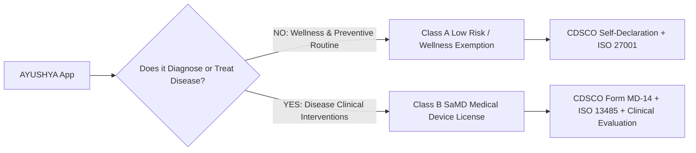

# ⚖️ AYUSHYA: Real-World Regulatory Compliance, Certifications & Legal Roadmap
> **Comprehensive Strategy & Legal Defense Guide for Commercial Launch & SIH-2026 Jury Review**  
> *Ministry of Ayush • CDSCO (SaMD) • FSSAI (Ayurveda Aahara) • NCISM Telemedicine Practice Guidelines • DPDP Act 2023*

---

## 🧭 1. Executive Summary: The Dual-Track Legal Reality

When transitioning AYUSHYA from an **SIH Prototype** to a **Commercial, Real-World Production Platform**, healthcare software in India falls strictly into one of two legal categories:

```
                                [HEALTHCARE SOFTWARE]
                                          │
                  ┌───────────────────────┴───────────────────────┐
                  ▼                                               ▼
         [TRACK 1: WELLNESS TOOL]                        [TRACK 2: SaMD / MEDICAL DEVICE]
     • Preventive lifestyle & chronobiology          • Direct herbal/drug prescriptions
     • Dosha assessment & daily diet (Ahara)         • Clinical diagnosis of pathology
     • Dinacharya & Ritucharya routines              • Therapeutic drug dosage calculation
     ───────────────────────────────────────         ───────────────────────────────────────
     ✅ ZERO Clinical Device Approval needed         ⚠️ CDSCO License + Clinical Trials +
     ✅ FSSAI Ayurveda Aahara Compliant              ⚠️ Registered BAMS Doctor-in-the-Loop
     ✅ Immediate Go-to-Market Safe                  ⚠️ Mandatory SaMD ISO 13485 & 62304
```

> [!IMPORTANT]
> **Why removing the raw `/herbal-guide` page from our hackathon prototype was a masterstroke:**  
> By keeping AYUSHYA firmly in **Track 1 (Preventive Wellness & Classical Chronobiology)**, our prototype operates **100% legally without regulatory friction**, avoiding the immediate cross-examination of: *"Who authorized this app to prescribe therapeutic drugs without pulse diagnosis?"*

---

## 🌿 2. If We Launch the "Herbal Guide / Prescription" Feature in Real Life: What Must Be Done?

If AYUSHYA decides to recommend or dispense herbal formulations in the commercial product, the following **mandatory actions, licenses, and verifications** must be completed:

### A. Regulatory Bodies to Verify With
1. **Ministry of Ayush (आयुष मंत्रालय)**:
   - State Licensing Authority (SLA - Ayush Department of the respective state).
   - **CCRAS (Central Council for Research in Ayurvedic Sciences)**: For clinical efficacy vetting.
2. **NCISM (National Commission for Indian System of Medicine)**:
   - Governing body for Ayurvedic practitioners under the NCISM Act, 2020.
3. **CDSCO (Central Drugs Standard Control Organisation)**:
   - India's national regulatory authority for medical devices, pharmaceuticals, and clinical software.
4. **FSSAI (Food Safety and Standards Authority of India)**:
   - For nutraceuticals, food-based herbs, and *Ayurveda Aahara*.

---

### B. Mandatory Licenses & Certifications (Detailed Breakdown)

#### 1. The Doctor-in-the-Loop Protocol (NCISM Telemedicine Guidelines, 2022)
*Under Indian law, AI cannot independently prescribe therapeutic Ayurvedic formulations.*
- **Mandatory Architecture:**
  - AI (AyurMitra) can only generate a **"Clinical Recommendation Draft"**.
  - A registered BAMS / MD(Ayu) practitioner possessing a valid **State Medical Council Registration** must review, verify, and digitally sign the prescription with their registration number.
  - The prescription must comply with **NCISM Telemedicine Practice Guidelines (Schedule 1)**.

#### 2. Drugs & Cosmetics Act, 1940 & Rules 1945 (Chapter IV-A)
- **Section 33EEB / Rule 158B:**
  - If AYUSHYA partners with or manufactures proprietary Ayurvedic formulations (*Patent or Proprietary Ayurvedic Medicines*), the manufacturer must hold a valid **Form 25D Manufacturing License**.
  - Proof of safety and efficacy must be established through citations in the **54 Authorized Classical Treatises** (First Schedule of the Drugs & Cosmetics Act), including *Charaka Samhita, Sushruta Samhita, Ashtanga Hridaya, and Bhavaprakasha Nighantu*.

#### 3. Schedule E(1) Poisonous & Restricted Substances Ban
- Ayurvedic medicine recognizes potent herbs that are toxic if unprocessed (e.g., *Vatsanabha (Aconite)*, *Bhallataka (Semecarpus)*, *Kupilu (Strychnos nux-vomica)*, *Ahiphena (Opium)*) or heavy-metal mineral *Rasa Shastra Bhasmas* (mercury, arsenic, lead).
- **Compliance Rule:** An online platform must strictly **prohibit self-prescription of any Schedule E(1) substance**. AI guardrails must reject any prompt attempting to self-dose toxic plants.

#### 4. FSSAI "Ayurveda Aahara" Regulations, 2022
- For non-prescription herbs, kitchen spices, and Rasayana foods (e.g. Chyawanprash, Amla juice, herbal teas, Ghee infusions):
  - Must obtain an **FSSAI Central License under Category 100 (Ayurveda Aahara)**.
  - The packaging and digital catalog must carry the official **Ayurveda Aahara Logo**.
  - Must not claim to *cure, treat, or prevent any specific disease* on the public interface without clinical trial data.

#### 5. Pharmacovigilance & Adverse Drug Reaction (ADR) Monitoring
- The platform must integrate an **Adverse Event Reporting System** linked to the **National Pharmacovigilance Centre for Ayush (NPCA)** at All India Institute of Ayurveda (AIIA), New Delhi, to report any allergic or adverse reactions.

---

## 💻 3. Software as a Medical Device (SaMD) & Digital Health Compliance

When software computes patient health indicators (like Prakriti scores, Vikriti shifts, and therapeutic dietary plans), Indian and international medical device regulations apply.



### Necessary Software Certifications:
| Standard / Act | Scope | Requirement for AYUSHYA |
| :--- | :--- | :--- |
| **CDSCO Medical Device Rules (MDR 2017)** | Software as a Medical Device (SaMD) | Classified as **Class A (Low Risk)** for lifestyle/diet, or **Class B** if providing clinical diagnostic decision support. |
| **ISO 13485:2016** | Medical Device Quality Management | Ensures software quality control, clinical safety risk management, and bug remediation audits. |
| **ISO 62304:2006** | Medical Device Software Lifecycle | Formal software architecture, verification, unit testing, and cybersecurity audit trails. |
| **IEC 62366** | Usability Engineering for Medical Devices | Ensures UI/UX does not cause human error in clinical recommendations. |

---

## 🔒 4. Data Privacy & Patient Record Standards (ABDM & DPDP)

Health data (Prakriti questionnaire answers, digestion logs, medical symptoms) is classified as **Sensitive Personal Data (SPD)**.

### A. Digital Personal Data Protection (DPDP) Act, 2023 (India)
1. **Explicit Consent Architecture:**
   - User must give affirmative, clear consent before diagnostic assessment (`consent_given_at` timestamp recorded in database).
2. **Right to Erasure & Data Portability:**
   - Users must be able to delete their assessment history or export their diagnostic profile in machine-readable JSON.
3. **Purpose Limitation:**
   - Diagnostic data cannot be shared with third-party advertisers or insurance companies without distinct opt-in consent.

### B. Ayushman Bharat Digital Mission (ABDM) Integration
To integrate with the Indian government's public digital health infrastructure:
1. **ABHA (Ayushman Bharat Health Account) Creation:**
   - Allow patients to link their 14-digit ABHA ID to AYUSHYA.
2. **M1, M2, M3 Milestone Certification by National Health Authority (NHA):**
   - **Milestone 1:** ABHA Registration and Authentication.
   - **Milestone 2:** Health Information Provider (HIP) — pushing Prakriti and diet reports to the patient's personal health locker (PHR app).
   - **Milestone 3:** Health Information User (HIU) — with patient consent, pulling medical history from hospital records to personalize Ayurvedic care.

---

## 🚀 5. Strategic 3-Phase Commercialization Roadmap

If AYUSHYA is launched as a startup:

```
┌─────────────────────────────────────────────────────────────────────────────┐
│ PHASE 1: PREVENTIVE WELLNESS & AHARA (Months 1–6) ── Zero Regulatory Risk   │
├─────────────────────────────────────────────────────────────────────────────┤
│ • Focus: Prakriti Phenotyping, Weekly Vikriti Delta, Dinacharya, Ritucharya│
│ • Commercial Classification: Lifestyle Wellness & FSSAI Ayurveda Aahara    │
│ • Legal Burden: Terms of Service Disclaimer + DPDP Act 2023 Compliance     │
│ • Revenue Model: Subscriptions, Certified Organic Kitchen Spices/Teas      │
└─────────────────────────────────────────────────────────────────────────────┘
                                       │
                                       ▼
┌─────────────────────────────────────────────────────────────────────────────┐
│ PHASE 2: TELE-AYURVEDA "DOCTOR-IN-THE-LOOP" (Months 6–12)                   │
├─────────────────────────────────────────────────────────────────────────────┤
│ • Focus: Hybrid AI-Vaidya Consultation (AyurMitra drafts, Doctor approves) │
│ • Regulatory: NCISM Telemedicine Practice Guidelines, 2022                 │
│ • Licensing: Onboarding Verified BAMS/MD Practitioners with Digital Sign   │
│ • Prescriptions: Verified herbal formulations dispatched through licensed  │
│   Ayush pharmacies (Form 25D partners)                                     │
└─────────────────────────────────────────────────────────────────────────────┘
                                       │
                                       ▼
┌─────────────────────────────────────────────────────────────────────────────┐
│ PHASE 3: CLINICALLY CERTIFIED SaMD PLATFORM (Months 12–24)                 │
├─────────────────────────────────────────────────────────────────────────────┤
│ • Focus: AI Diagnostic Decision Support for Chronic Metabolic Disorders    │
│ • Clinical Trials: CTRI Registration + CCRAS Efficacy Trial Protocol       │
│ • Certification: CDSCO Class B Medical Device License + ISO 13485 / 62304  │
│ • ABDM M3 Milestone Certification (NHA Integration)                        │
└─────────────────────────────────────────────────────────────────────────────┘
```

---

## 🎤 6. How to Explain This Strategy to SIH Judges

When asked: *"Why did you not include direct herbal medicine purchasing or prescription in your app?"*

> **Your Winning Answer:**  
> *"Sir/Ma'am, in healthcare, responsible compliance is as important as technology. Under the **Drugs & Cosmetics Act** and **NCISM Telemedicine Guidelines (2022)**, an AI algorithm cannot legally prescribe therapeutic herbs without an in-person pulse diagnosis (*Nadi Pariksha*) by a registered BAMS practitioner.  
>  
> Therefore, we engineered AYUSHYA as a **100% compliant Preventive Chronobiology & Nutritional Platform (Ahara & Vihara)**. We focus on classical dietary guidelines, seasonal Ritucharya, and lifestyle modification—which has zero toxicity risk. For herbs, AyurMitra acts strictly as an **educational classical reference (Shastriya Pramana)** with strict medical disclaimers and emergency triaging. In our Phase 2 roadmap, we integrate a licensed Doctor-in-the-Loop tele-consultation pipeline to prescribe herbs legally."*

---
*Created for the AYUSHYA Engineering & Regulatory Team • SIH-2026*
