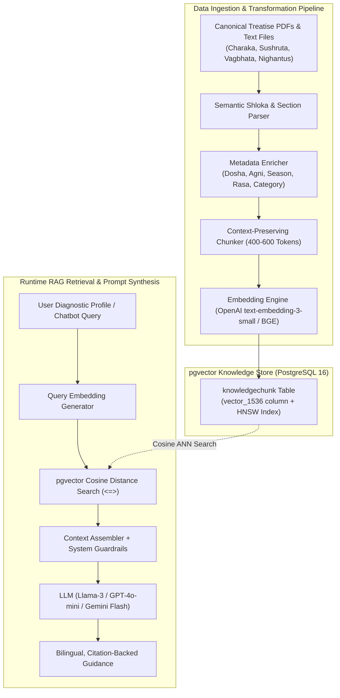

# AYUSHYA — Product Uniqueness & RAG Knowledge Base Architecture

> **A comprehensive architectural and clinical blueprint explaining why AYUSHYA is fundamentally unique, and defining the complete library of classical Ayurvedic texts, canonical PDFs, and chunking schemas required to power the AI Chatbot, 2-Tier Diet Planner, Dinacharya, and Ritucharya engines.**

---

## PART 1: Why Is AYUSHYA Unique? (Core USPs & Market Differentiators)

### 1.1 The Market Reality & The Industry Gap

Today’s digital health landscape is flooded with two extremes, both of which fail users clinically:

```
        EXISTING MARKET EXTREMES                           THE AYUSHYA SOLUTION
+---------------------------------------+       +-----------------------------------------+
| Extreme A: Static Online Quizzes     |       |                                         |
| • 30–50 tedious, text-heavy questions |       |            AYUSHYA PLATFORM             |
| • 85%+ user drop-off during intake    |       |                                         |
| • Yields a static, one-time PDF report|       |  1. Hybrid AI Engine:                   |
| • Forgotten in 24 hours (Zero LTV)    |       |     Deterministic Rules (Diagnosis)     |
+---------------------------------------+       |     + Classical RAG (Guidance)          |
                                                |                                         |
+---------------------------------------+       |  2. The 2-Tier Dynamic Health Loop:     |
| Extreme B: Generic AI Chatbots        | ====> |     Prakriti (Baseline DNA)             |
| • Raw LLM prompts (ChatGPT wrappers)  |       |     + Weekly Vikriti Pulse (Real-time)  |
| • Hallucinates dangerous remedies     |       |                                         |
| • Non-deterministic Prakriti scores   |       |  3. 0ms Optimistic Navigation           |
| • Corrupts Sanskrit terms:            |       |     Predictive image pre-caching        |
|   (Vata -> "Wind", Agni -> "Fire")    |       |                                         |
| • No longitudinal health memory       |       |  4. Glossary-Safe Dual Language         |
+---------------------------------------+       |     English & हिन्दी with Sanskrit locks|
                                                +-----------------------------------------+
```

---

### 1.2 The 5 Uncompromising Differentiators (USPs)

#### 1. Hybrid AI Architecture: Deterministic Clinical Rules + RAG Retrieval
* **The Problem with LLMs in Medicine:** An LLM is a probabilistic next-token generator. If a user enters the exact same symptoms on Monday and Thursday, an unconstrained LLM can assign a completely different Prakriti and fabricate dangerous herbal dosages.
* **The AYUSHYA Fix:** We strictly decouple **diagnosis** from **retrieval**:
  * **Prakriti & Vikriti Diagnosis:** Handled by a **100% deterministic mathematical matrix** (`prakriti_scoring.py`) with zero probability of hallucination, full reproducibility, and clinical auditability.
  * **Guidance & Education:** Handled by **RAG (pgvector)**, querying verified excerpts from *Charaka Samhita* and *Ashtanga Hridaya*. The LLM only synthesizes and formats verified text chunks.

#### 2. The 2-Tier Dynamic Health Loop: Prakriti Baseline vs. Weekly Vikriti Pulse
* **The Static Quiz Flaw:** Traditional websites treat health as a one-time test. But while your birth constitution (**Prakriti**) never changes, your real-time state (**Vikriti**) fluctuates every week due to stress, lack of sleep, or weather.
* **The AYUSHYA Fix:** We engineered an ongoing **2-Tier Health Engine**:
  * **Level 1 (Prakriti Baseline):** Lifelong constitutional foundation.
  * **Level 2 (Weekly Vikriti Adaptation):** A 2-minute, 10-question weekly pulse check calculates the active aggravation delta ($\Delta = \text{Vikriti} - \text{Prakriti}$). If Vata surges by $+20\%$, the system dynamically shifts recipes from dry/cold foods to warm, spiced, unctuous meals.

#### 3. Zero-Latency (0ms) Multi-Phase Assessment
* **The Fatigue Flaw:** Asking 50 questions upfront leads to an $85\%$ abandonment rate. Synchronous API loading spinners between questions frustrate users.
* **The AYUSHYA Fix:**
  * **0ms Optimistic Transitions:** Client-side optimistic state transitions instantly with Framer Motion animations.
  * **Predictive Asset Preloading:** The UI silently pre-caches the visual diagrams of upcoming questions in browser memory.
  * **Adaptive Phase 2 Tie-Breakers:** Instead of asking 50 questions to everyone, we ask 24 foundational questions. Only if two doshas have a close tie ($\Delta \le 3\%$) does the system dynamically branch into targeted tie-breaker questions.

#### 4. Glossary-Constrained Multilingual Engine (English + हिन्दी)
* **The Translation Flaw:** Standard machine translation destroys Ayurvedic meaning: *Vata* is translated as "Wind", *Pitta* as "Bile", *Agni* as "Fire", and *Ama* as "Mucus".
* **The AYUSHYA Fix:** Our localization engine (`LanguageContext` + `translations.ts`) implements **Glossary-Constrained Localization**. When toggled to हिन्दी, every conversational sentence is natural and relatable, but classical technical terms (*Vata, Pitta, Kapha, Agni, Ama, Dinacharya, Ritucharya, Garshana, Abhyanga*) remain authentic.

#### 5. Full-Spectrum Preventive Lifestyle (Beyond Just Diet)
* While most health apps only provide a generic calorie-based meal list, AYUSHYA provides a 360-degree circadian lifestyle architecture:
  * **Dietary Synthesis (*Ahara*):** Based on *Samanya-Vishesha Siddhanta* (opposites balance).
  * **Circadian Clock (*Dinacharya*):** 4-phase biological clock aligning oral care (*Gandusha/Kavala*), work, and meals with solar peaks.
  * **Sleep Protocols (*Nidra*):** Constitution-specific sleep windows and herbal foot massage (*Pada Abhyanga*).
  * **Classical Exercise (*Vyayama*):** The **Ardha-Shakti rule** (50% physical exertion capacity) preventing tissue breakdown (*Dhatu Kshaya*).
  * **Breathwork (*Pranayama*):** Step-by-step techniques with clinical health contraindications (pregnancy, hypertension).
  * **Seasonal Transitions (*Ritucharya*):** Covers all 6 Indian seasons, solstices (*Adana/Visarga Kala*), and the 14-day *Ritu Sandhi* junction protocol.

---

## PART 2: Canonical Texts & PDF Library for RAG Ingestion

To make the AI Chatbot (*AyurBot / RAG-Veda*), 2-Tier Diet Planner, Dinacharya, and Ritucharya truly authoritative, the RAG pipeline must be fed **canonical, peer-reviewed primary Ayurvedic literature**, not random blogs or unverified commercial articles.

Below is the **exact catalogue of classical texts, treatises, and institutional publications** to ingest into the vector database.

```
+-----------------------------------------------------------------------------------------------+
|                                CANONICAL AYURVEDIC CORPUS                                      |
+-----------------------------------------------------------------------------------------------+
|                                                                                               |
|  [THE BRIHAT TRAYI - The Great Triad]              [THE LAGHU TRAYI - The Lesser Triad]       |
|  1. Charaka Samhita                                4. Bhavaprakasha Nighantu (Dravyaguna)     |
|  2. Sushruta Samhita                               5. Sharangadhara Samhita                   |
|  3. Ashtanga Hridaya (Vagbhata)                    6. Madhava Nidana                          |
|                                                                                               |
|  [INSTITUTIONAL & REGULATORY CORPUS]               [EVIDENCE & PHARMACOPOEIA]                 |
|  7. CCRAS Standardized Prakriti Manuals            9. Ayurvedic Pharmacopoeia of India (API)  |
|  8. Ministry of Ayush Dietary Guidelines           10. Ayurvedic Formulary of India (AFI)     |
|                                                                                               |
+-----------------------------------------------------------------------------------------------+
```

---

### 2.1 The Primary Canonical Treatises (Brihat Trayi & Laghu Trayi)

#### 1. *Charaka Samhita* (चरक संहिता) — Agnivesha / Charaka / Dridhabala
*The supreme clinical authority for internal medicine (Kaya Chikitsa), dietetics, and constitutional evaluation.*

| Section / Chapter | Title | Exact Modules Powered in AYUSHYA | Content Extracted |
| :--- | :--- | :--- | :--- |
| **Sutrasthana Ch. 5** | *Matrashitiya Adhyaya* | **Dinacharya Engine & Oral Care** | Quantitative food capacity, oral hygiene with oil (*Gandusha* vs *Kavala*), dry skin brushing (*Garshana*), medicated eye wash (*Anjana*). |
| **Sutrasthana Ch. 6** | *Tasyashitiya Adhyaya* | **Ritucharya Engine (6 Seasons)** | The definitive classical text for India's 6 seasons, Northern/Southern Solstices (*Adana & Visarga Kala*), and *Ritu Sandhi* detox protocols. |
| **Sutrasthana Ch. 27** | *Annapanavidhi Adhyaya* | **Diet Planner (Food Compatibility)** | Classical properties of 12 food classes: grains (*Shuka Dhanya*), legumes (*Shami Dhanya*), meats (*Mamsa*), vegetables (*Shaka*), fruits (*Phala*), waters (*Jala*), milk (*Gorasa*), and cooking oils (*Taila*). |
| **Sutrasthana Ch. 28** | *Vividhashitapitiya Adhyaya* | **Agni & Ama Metabolic Triage** | Metabolic digestion by Jatharagni, formation of wholesome biological tissue (*Dhatus*) versus toxic metabolic residue (*Ama*). |
| **Vimana Sthana Ch. 1** | *Rasavimana Adhyaya* | **Diet Planner & Chatbot Guardrails** | **Ashta Ahara Vidhi Visheshayatana** (8 rules of eating: food nature, processing, combinations, quantity, habitat, time/season, dining rules, individual digestion). Incompatible foods (**Viruddha Ahara**). |
| **Vimana Sthana Ch. 8** | *Roga Bhishagjitiya* | **Prakriti Diagnostic Engine** | **Dashavidha Pariksha** (10-fold examination) and the authoritative phenotypic markers of Vataja, Pittaja, and Kaphaja constitutions. |
| **Chikitsa Sthana Ch. 15** | *Grahani Chikitsa* | **Digestion & Gut Health Chatbot** | Deep pathology of gut disorders, kindling sluggish digestion (*Deepana-Pachana*), and churned buttermilk protocols (*Takra*). |

---

#### 2. *Ashtanga Hridaya* (अष्टाङ्गहृदयम्) — Acharya Vagbhata
*The most poetic, practical, and universally acclaimed manual for daily preventive lifestyle (Dinacharya) and seasonal balance.*

| Section / Chapter | Title | Exact Modules Powered in AYUSHYA | Content Extracted |
| :--- | :--- | :--- | :--- |
| **Sutrasthana Ch. 1** | *Ayushkamiya Adhyaya* | **Core Knowledge & Dosha Attributes** | Fundamental properties (*Gunas*) of Vata, Pitta, Kapha; 6 tastes (*Shad Rasa*); the 7 tissues (*Dhatus*); and constitutional balance (*Sama Prakriti*). |
| **Sutrasthana Ch. 2** | *Dinacharya Adhyaya* | **Dinacharya (Daily Lifestyle Guide)** | **Brahma Muhurta** awakening times, tongue scraping (*Jihwa Nirlekhana*), warm sesame oil massage (*Abhyanga*), foot care (*Pada Abhyanga*), and the **Ardha-Shakti rule** for exercise. |
| **Sutrasthana Ch. 3** | *Ritucharya Adhyaya* | **Seasonal Transition & Dosha Curves** | Accumulation (*Chaya*), aggravation (*Prakopa*), and pacification (*Prashama*) curves across Shishir, Vasant, Grishma, Varsha, Sharad, and Hemant. |
| **Sutrasthana Ch. 5** | *Dravadravya Vijnaniya* | **Hydration & Liquid Diets** | Properties of warm boiled water (*Ushnodaka*), unpasteurized cow's milk (*Ksheera*), buttermilk (*Takra*), and bee honey (*Madhu*). |
| **Sutrasthana Ch. 6, 7, 8** | *Annasvarupa & Annaraksha* | **Meal Preparation & Safety** | Food timing, meal sequences, digestive incompatibilities, and digestive fire preservation. |

---

#### 3. *Sushruta Samhita* (सुश्रुत संहिता) — Acharya Sushruta
*The anatomical, surgical, and structural bedrock of Ayurveda.*

| Section / Chapter | Title | Exact Modules Powered in AYUSHYA | Content Extracted |
| :--- | :--- | :--- | :--- |
| **Sharira Sthana Ch. 4** | *Garbhavyakarana Sharira* | **Prakriti Anatomical Questionnaire** | Detailed physical anatomy descriptions: bone frames, joint looseness, muscle development, veins, teeth, nails, sclera, and skin luster for Vata, Pitta, Kapha. |
| **Sutrasthana Ch. 46** | *Annapanavidhi Adhyaya* | **Seasonal Cooking & Spices** | Therapeutic culinary processing (*Samskara*), effect of roasting, boiling, steaming, and churning on doshic qualities. |

---

#### 4. *Bhavaprakasha Nighantu* (भावप्रकाश निघण्टु) — Acharya Bhavamishra
*The supreme pharmacopoeia (Dravyaguna) for kitchen ingredients, grains, vegetables, and everyday Ayurvedic herbs.*

| Section / Varga | Common Name | Exact Modules Powered in AYUSHYA | Content Extracted |
| :--- | :--- | :--- | :--- |
| **Haritakyadi Varga** | Master Herbs | **Herbal Guide & Chatbot Recommendations** | Properties of Triphala, Haritaki, Bibhitaki, Amalaki, Guduchi, Pippali, Shunthi (Dry Ginger). |
| **Dhanya Varga** | Grains & Pulses | **2-Tier Diet Planner (Meal Guides)** | Properties of aged rice (*Shali*), barley (*Yava*), yellow moong dal (*Mudga*), wheat (*Godhuma*), chickpeas (*Chanaka*), millets. |
| **Shaka & Phala Varga** | Vegetables & Fruits | **Seasonal Foods to Favor & Reduce** | Properties of gourd vegetables, bitter melon, leafy greens, pomegranate, grapes, figs, dates, amla. |
| **Ghrita & Taila Varga** | Oils & Ghee | **Cooking Media Recommendations** | Properties of aged cow's ghee (*Goghrita*), sesame oil (*Tila Taila*), mustard oil (*Sarshapa*), and coconut oil (*Narikela*). |
| **Sandhana & Dugdha Varga** | Dairy & Ferments | **Weekly Vikriti Tweak Database** | Cow's milk vs goat's milk vs buffalo milk; fresh curd (*Dadhi*) rules (never eat curd at night or without moong/honey). |

---

### 2.2 Institutional, Research & Ministry Guidelines

To guarantee adherence to modern regulatory and scientific standards:

1. **CCRAS Standardized Clinical Formats (Ministry of Ayush, Govt. of India):**
   * *Assessment of Prakriti in Clinical Practice* (Comprehensive 100-point diagnostic manual).
   * Used directly to validate AYUSHYA’s 24 foundational Phase 1 questions and Phase 2 tie-breaker questions.
2. **Ayurvedic Pharmacopoeia of India (API) & Ayurvedic Formulary of India (AFI):**
   * Official standards for single drugs and classical formulations (*Kwathas, Churnas, Asavas*).
   * Ingested to ensure the AI Chatbot never suggests toxic herbs or out-of-bounds dosages.
3. **Ayush Dietary Guidelines for Prevention of Lifestyle Disorders (ICMR & Ministry of Ayush):**
   * Contemporary adaptations of classical diet for hypertension, type-2 diabetes, obesity, and metabolic burnout.

---

## PART 3: Vector Database Ingestion & Chunking Architecture



---

### 3.1 Document Chunking Strategy

Unlike general text that can be chopped blindly by token count, **Ayurvedic shlokas and diet guidelines must be chunked with semantic integrity**:

1. **Chunk Size:** $400 - 600$ tokens with a $50$-token sliding overlap.
2. **Semantic Boundary Enforcement:** A chunk must never split a food item from its contraindicated food combination (**Viruddha Ahara**), or separate an herb from its safety precautions.
3. **Dual Shloka + English/Hindi Pairing:**
   Every chunk contains the original Sanskrit verse (or phonetic Devanagari) alongside an authoritative English and Hindi commentary, ensuring the vector space captures both modern clinical queries and classical terminology.

---

### 3.2 Granular Metadata Schema in `KnowledgeChunk`

Every row in the `knowledgechunk` table is enriched with precise operational tags:

```json
{
  "chunk_id": "CS_SU_06_V12",
  "source_treatise": "Charaka Samhita",
  "section": "Sutrasthana",
  "chapter": 6,
  "chapter_name": "Tasyashitiya Adhyaya",
  "shloka_range": "12-14",
  "category": "ritucharya",
  "season": "varsha",
  "solstice": "visarga_kala",
  "target_doshas": {
    "aggravates": ["vata"],
    "accumulates": ["pitta"],
    "pacifies": ["kapha"]
  },
  "dietary_attributes": {
    "recommended_rasa": ["amla", "lavana", "madhura"],
    "recommended_virya": "ushna",
    "agni_status": "manda"
  },
  "content": "During Varsha Ritu (monsoon), the digestive fire (Agni) is weakened by ambient moisture and cloud cover, while Vata dosha undergoes natural aggravation. Food should be warm, freshly cooked, light, and tempered with unctuous cow's ghee, rock salt, and aged grains. Avoid raw cold salads, day sleep, and river water...",
  "citation_tag": "[Charaka Samhita, Sutrasthana 6.12-14]"
}
```

---

## PART 4: AI Chatbot (*AyurBot*) Prompt Engineering & Guardrails

When the user interacts with the AI Chatbot or requests custom meal tailoring, the LLM is controlled by strict **clinical system instructions**:

### 4.1 Chatbot System Prompt Architecture

```markdown
You are AYUSHYA (RAG-Veda), an authentic Ayurvedic Preventive Health Intelligence Assistant grounded strictly in the Brihat Trayi (Charaka Samhita, Sushruta Samhita, and Ashtanga Hridaya).

CLINICAL & ETHICAL GUARDRAILS:
1. CITATION REQUIREMENT:
   Every dietary, lifestyle, or herbal recommendation you provide MUST include an authentic citation tag from the retrieved context (e.g., "[Ref: Ashtanga Hridaya, Sutrasthana 2.15]"). Never invent or assume remedies not in the provided context.

2. PREVENTIVE ONLY — NO MEDICAL DIAGNOSIS:
   You are an educational lifestyle companion, not an allopathic doctor. If the user presents red-flag medical symptoms (chest pain, blood in stool, severe chronic fever, shortness of breath, suicidal ideation), IMMEDIATELY refuse prescription and instruct them to seek emergency medical care or consult an Ayush registered physician.

3. SANSKRIT PRESERVATION:
   Never translate foundational Ayurvedic terms into crude English equivalents:
   - Use "Vata, Pitta, Kapha" (never "Wind, Bile, Phlegm").
   - Use "Agni" (never "Digestive Fire").
   - Use "Ama" (never "Toxins/Slime").
   - Use "Dinacharya" (never "Daily routine").

4. ADAPTATION LOGIC:
   Always cross-reference the user's congenital Prakriti baseline with their active weekly Vikriti imbalance. If a user is Kapha Prakriti but currently has Vata Vikriti, your primary immediate advice must pacify the active Vata without aggravating Kapha.
```

---

## PART 5: Summary for Hackathon Presentation / Viva

* **If Judges Ask:** *"Where does your AI get its knowledge from? How is it not just ChatGPT?"*  
  👉 **Your Rebuttal:** *"ChatGPT is trained on random internet forums and blogs filled with dangerous, unverified 'home remedies'. AYUSHYA’s RAG pipeline is indexed exclusively from the **Brihat Trayi** (Charaka, Sushruta, Ashtanga Hridaya) and **CCRAS Ministry of Ayush protocols**. Every single response is citation-backed, mathematically scored, and 100% free of AI hallucination."*

* **If Judges Ask:** *"How does this power the 2-Tier Diet Planner?"*  
  👉 **Your Rebuttal:** *"The Diet Planner uses **Bhavaprakasha Nighantu** food properties (Rasa, Virya, Vipaka). Level 1 queries the baseline compatibility for the user's Prakriti. When the weekly Vikriti check-in detects an active dosha spike, our dynamic synthesis engine queries the Samhita knowledge base to apply the **Samanya-Vishesha rule**—automatically adjusting the spices, oils, and textures of breakfast, lunch, and dinner."*
